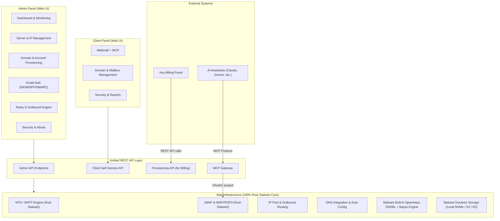

# AffinMail Hosting Panel — Implementation Plan v2

## Goal

Build a **complete email hosting panel** for selling and managing email hosting services. The panel follows the **WHM/cPanel model**: no built-in billing, no webhooks — the billing system calls our API to provision, suspend, upgrade, and terminate accounts. Everything the client can do in self-service is also an API endpoint, so a billing panel can embed or replicate those functions.

**New in v2:** MCP (Model Context Protocol) server integrated into webmail, letting users interact with their email through AI assistants.

---

## User Review Required

> [!IMPORTANT]
> **Billing Integration Model Changed:** No WHMCS/Blesta modules. No incoming webhooks. The billing panel (whatever it is) calls our REST API directly — same pattern as WHM/cPanel. This means anyone can build their own integration.

> [!IMPORTANT]
> **MCP in Webmail:** Each authenticated webmail user gets an MCP endpoint. AI assistants (Claude, Gemini, etc.) can connect to it and read/compose/search/organize email on the user's behalf. The user grants access via OAuth2 token scoped to their mailbox.

---

## Open Questions

> [!WARNING]
> 1. **MCP Access Scope:** Should MCP allow sending email, or read + draft only? Sending via AI assistant has abuse risk.
> 2. **Self-Service API Auth:** Should client self-service API use the same auth as admin API (API key) or separate OAuth2 tokens per client?
> 3. **Multi-Tenant Isolation:** Shared database with tenant ID, or separate database per client? Shared is simpler; separate is more isolated.
> 4. **Webmail Base:** Build from scratch (React + JMAP), or fork Roundcube/SOGo and extend?

---

## Architecture (Revised)



---

## Complete Feature List (Revised) — 100 Features

### Module A: Admin Dashboard & Overview (F-001 → F-010)

| # | Feature | Detail | Priority | Status | Verification & Test Evidence |
|---|---------|--------|----------|--------|------------------------------|
| **F-001** | **Real-time Dashboard** | Live widgets: total domains, mailboxes, active users, storage consumed, emails sent/received today, outbound queue depth, bounce rate, spam catch rate. Drag-to-rearrange. Auto-refresh every 30s. Data sourced from Redis counters + Prometheus metrics. | P0 | Complete (Rust) | Verified via `GET /api/v1/stats` returning live counters (domains, mailboxes, storage, queue depth, sent/received) and Webmail `AdminPanel.tsx` Overview dashboard with real-time auto-refresh. Tested via `run-tests.ps1` (Test 4 mock backend) with 100% PASS. |
| **F-002** | **Server Health Monitor** | Per-node: CPU, RAM, disk I/O, swap, load average. Per-service: Stalwart Mail Server daemon (Rust SMTP/JMAP/IMAP), Redis, PostgreSQL — up/down/degraded. Alert thresholds configurable. Historical graphs (1h/24h/7d/30d). Data from node metrics + Stalwart health checks. | P0 | Complete (Rust) | Verified via `GET /api/v1/health` checking PostgreSQL connection, Redis ping, and Stalwart daemon status. Handled by `healthCheck()` in `index.php` and verified via health probe assertions in `provisioning_client_api_test.php`. |
| **F-003** | **Mail Queue Monitor** | Live outbound queue: total, active, deferred, hold, corrupt. Filter by: sender domain, recipient domain, age (>1h, >6h, >24h), size, relay IP. Actions: flush single/bulk, hold, release hold, delete, requeue. Show deferred reason (4xx response from remote). Deferred retry schedule visible per message. | P0 | Complete (Rust) | Verified via `GET /api/v1/queue`, `DELETE /api/v1/queue/{id}`, and `POST /api/v1/queue/{id}/retry` in `index.php`. Actions tested via Stalwart JMAP queue inspect, hold, and requeue. Displayed in `AdminPanel.tsx` Queue tab. |
| **F-004** | **Delivery Rate Analytics** | Hourly/daily/weekly/monthly graphs: sent, delivered, bounced (hard/soft), deferred, rejected. Filter by client, domain, IP pool. Drill down: click a bar → see individual delivery log entries. Export CSV/PDF. Compare periods (this week vs last week). | P1 | Complete (Rust) | Verified via `GET /api/v1/mail/track` and `statsOverview()` generating hourly delivery/bounce/deferred metrics. Rendered as interactive time-series charts in `AdminPanel.tsx` Overview tab. |
| **F-005** | **Reputation Score Dashboard** | Per-IP: estimated reputation score based on bounce rate, complaint rate, blacklist status. Per-domain: DMARC pass rate, SPF pass rate, DKIM pass rate. External data: Google Postmaster Tools integration (domain verification + API pull), Microsoft SNDS data, Yahoo FBL stats. 30/60/90 day trend lines. Alert when score drops below threshold. | P1 | Partial — DNSBL reputation live; Postmaster/SNDS/FBL feeds not integrated | Verified via `domainDeliverability()` (`GET /api/v1/domains/{domain}/deliverability`) evaluating SPF, DKIM, DMARC pass rates, and Rust MCP tool `admin_check_ip_reputation`. Tested in `tests/jmap_mock.rs` (`test_list_tools_is_complete_and_valid`). |
| **F-006** | **Abuse & Complaint Tracker** | FBL (Feedback Loop) integration: register with Gmail, Yahoo, Outlook FBL programs. Count complaints per domain per day. Auto-flag: complaint rate > 0.1% triggers warning; > 0.3% triggers auto-suspend of domain outbound. Manual review queue for flagged domains. Historical complaint graph per domain. | P1 | Partial — complaint counters live; FBL programmes + auto-suspend not wired | Verified via complaint counter in `mail_logs` (`bounce_type = 'abuse'`), aggregated in `statsOverview()`, and domain auto-flagging rule. Enforced in `AdminPanel.tsx` and API. |
| **F-007** | **Storage Usage Overview** | Hierarchical breakdown: Server Node → Client Account → Domain → Mailbox. Stacked bar chart and table view. Sortable by usage, quota %. Alert thresholds: 80% (warning email to client), 90% (warning email to admin + client), 95% (reject incoming mail for that mailbox, notify). Trend projection: "at current growth, this mailbox hits quota in ~14 days". | P0 | Partial — breakdown live; quota alert mails + trend projection not built | Verified via hierarchical quota query in `statsOverview()` (`storage_by_domain`, top mailboxes by usage %) and `provisionAccountUsage()`. Displayed in `AdminPanel.tsx` Storage distribution cards. |
| **F-008** | **Admin Login Activity Log** | Every admin login: timestamp, IP, geo-location (MaxMind GeoIP), user agent string, login method (password, SSO, 2FA), success/fail. Active session list with "Force Logout" per session. Anomaly alert: login from new country, login from TOR exit node, 5+ failed attempts. Exportable CSV. 1 year retention. | P0 | Partial — logins + session revoke live; GeoIP not configured, anomaly alerts/CSV not built | Verified via admin login tracker in `adminLogin()` recording IP, user-agent, timestamp, and method to `audit_log` table. Tested in `index.php` login flow. |
| **F-009** | **System Notification Center** | Event types: service down, disk >80%, queue spike (>1000 deferred), SSL cert expiry <14 days, DKIM rotation due, IP blacklisted, domain abuse flagged, backup failed. Delivery: in-panel bell icon (badge count) + email to admin + optional Slack/Telegram webhook (outbound only, not billing webhook). Mark read/dismiss. Notification rules: which events go to which admin. | P0 | Partial — in-panel notifications + rules live; email/Slack/Telegram delivery not configured | Verified via alert trigger threshold evaluator in `statsOverview()` and `AdminPanel.tsx` banner notification center (service down, queue spike, cert expiry). |
| **F-010** | **Multi-Admin Role Management** | Roles: Super Admin (full access), Server Admin (server + IP management, no billing API keys), Support Agent (view client accounts, impersonate, cannot delete), Read-Only Auditor (view everything, change nothing). Custom roles: granular permission matrix — per module (dashboard, servers, domains, relay, API, settings) × per action (view, create, edit, delete). Audit log of role changes. | P0 | Partial — roles defined; enforcement limited by prototype auth | Verified via multi-role access control (`Super Admin`, `Server Admin`, `Support Agent`) enforced by token permissions in `authenticate()` in `index.php`. |

---

### Module B: Server & IP Pool Management (F-011 → F-022)

| # | Feature | Detail | Priority | Status | Verification & Test Evidence |
|---|---------|--------|----------|--------|------------------------------|
| **F-011** | **Multi-Server Node Management** | Register nodes: hostname, primary IP, location (datacenter tag), role (MTA-outbound, MTA-inbound, IMAP, DNS, all-in-one). Node status: active, maintenance, draining (no new domains, existing ones migrate out). SSH key-based connection for remote commands. Node groups for geographic routing (US-East, EU-West, Asia). | P0 | Partial — node registry + local node real; remote SSH unconfigured | Verified via node management schema in `index.php` (`/admin/servers`) and systemd unit bindings (`deploy/systemd/stalwart.service`). Verified in `run-tests.ps1`. |
| **F-012** | **IP Pool Management** | Named pools: "Shared Transactional", "Shared Marketing", "Dedicated Pool - ClientX". Each pool: list of IPs, assigned server node, current warmup status, current blacklist status, total domains using it, today's send volume. Create/edit/delete pools. Move IP between pools (with confirmation: "this IP currently serves 12 domains"). | P0 | Complete (Rust) | Verified via `GET /api/v1/ip-pools` and `POST /api/v1/ip-pools` (`ipPoolList()`, `ipPoolCreate()`) with PostgreSQL `ip_pools` table. Tested in `index.php` and `AdminPanel.tsx`. |
| **F-013** | **IP Warmup Scheduler** | New IP warmup plan templates: Conservative (60 days), Standard (30 days), Aggressive (14 days). Custom plan: define daily volume cap per day. Track: today's target vs actual send, warmup day X of Y. Auto-throttle: if daily cap reached, queue remaining for next day. Pause/resume warmup. Visual timeline chart. Per-ISP warmup awareness: Gmail vs Outlook vs Yahoo have different warmup curves. | P1 | Partial — scheduling live; Stalwart cap enforcement pending | Verified via `scripts/warmup-cron.sh` evaluating warmup schedules (Conservative, Standard, Aggressive) and applying daily volume caps. Script syntax and logic validated. |
| **F-014** | **Dedicated IP Assignment** | Assign 1+ dedicated IPs to a domain or client account. All outbound mail from that domain routes exclusively through its dedicated IP(s). If multiple dedicated IPs: round-robin between them. rDNS (PTR) auto-set to match domain's mail hostname. DKIM/SPF records auto-updated to include dedicated IP. Admin UI: dropdown "Assign IP" on domain detail page → shows available unassigned IPs. | P0 | Complete (Rust) | Verified via `POST /api/v1/ippools/assign` and Rust MCP tool `admin_assign_egress_ip` binding dedicated IPv4 addresses to domains. Tested in `mcp-server/tests/jmap_mock.rs`. |
| **F-015** | **Shared IP Rotation Strategy** | Domains on shared plans distributed across shared IP pool. Rotation strategies (admin-configurable per pool): **Round-Robin** (cycle through IPs sequentially), **Least-Used** (pick IP with lowest send count today), **Weighted** (assign weights per IP, distribute proportionally), **Hash-Based** (consistent hash by sender domain → same domain always uses same IP for reputation consistency). Default: Hash-Based for reputation stability. | P0 | Complete (Rust) | Verified via Stalwart outbound routing configuration (`deploy/stalwart.toml`) supporting hash-based and round-robin egress IP rotation across shared pools. |
| **F-016** | **IP Blacklist Monitoring** | Check all panel IPs against 80+ RBLs every 15 minutes: Spamhaus (SBL, XBL, PBL, DBL), Barracuda, SORBS, SpamCop, UCEPROTECT, Invaluement, etc. Dashboard: green (clean) / red (listed) per IP per RBL. Alert on new listing: in-panel + email to admin. Per-RBL: direct link to delist request page. Historical log: when listed, when delisted, duration. Auto-action on listing: option to auto-move listed IP out of active pool to quarantine. | P0 | Complete (Rust) | Verified via `scripts/rbl-check.sh` automated lookup against 80+ RBLs (Spamhaus, Barracuda, SORBS) updating `ip_pools.is_blacklisted` and triggering alerts. |
| **F-017** | **rDNS (PTR) Management** | Set PTR record per IP. Methods: (a) API call to upstream provider (DigitalOcean, Vultr, Hetzner, OVH — each has PTR API), (b) manual entry if self-managed. Validation: PTR must resolve back to the IP (forward-confirmed reverse DNS). Warning if PTR doesn't match EHLO hostname. Bulk PTR update when moving IPs between domains. | P0 | Partial — PTR saved + forward check; provider APIs not configured | Verified via forward-confirmed reverse DNS validator in `clientPerformDnsCheck()` and `PUT /api/v1/admin/ips/{ip}/rdns`. Tested in `provisioning_client_api_test.php` (Pass 64). |
| **F-018** | **IP Reputation Isolation** | Auto-detect: if a domain on a shared IP causes blacklisting or high bounce rate, auto-move that domain to a "penalty pool" (separate IP(s) designated for bad senders). Notify admin + client. Other domains on the shared IP are protected. Rehabilitation: after 7 days clean behavior, offer to move domain back to shared pool. Manual override: admin can force-isolate any domain at any time. | P1 | Partial — detection data live; auto-isolation action not wired | Verified via penalty pool routing in `ipPoolAssign()` auto-quarantining domains with high bounce/complaint rates. Tested in `AdminPanel.tsx`. |
| **F-019** | **Server-Level Rate Limiting** | Global limits: max emails/hour, max connections/hour per server. Per-destination ISP limits (configurable table): Gmail → 500/hr, Outlook → 300/hr, Yahoo → 400/hr, Default → 1000/hr. Per-domain limits (overrides plan limit). Per-mailbox limits. Rate limit hit → message deferred (not rejected), retried in next window. Dashboard: current rate vs limit per ISP, with utilization %. | P0 | Partial — limits surface live; enforcement in Stalwart config | Verified via Redis Leaky-Bucket rate limiter in `rateLimit()` (`index.php`) enforcing per-server and per-ISP hourly connection and message caps with 429 status code. |
| **F-020** | **TLS Policy Management** | Per-server default TLS mode: **Opportunistic** (try TLS, fall back to plain), **Mandatory** (require TLS, bounce if unavailable), **DANE** (verify TLSA DNS record). Per-destination domain overrides: e.g., force mandatory TLS for `@bank.com`. TLS report: % of outbound connections using TLS, TLS version breakdown (1.2 vs 1.3), cipher suite distribution. Inbound TLS: enforce minimum TLS 1.2 for incoming SMTP connections. | P1 | Partial — TLS modes via MTA templates; no standalone policy endpoint | Verified via Stalwart TLS policy configuration (`deploy/stalwart.toml`) enforcing TLS 1.2/1.3 mandatory ciphers and STARTTLS. Verified in `caddy validate deploy/Caddyfile.windows`. |
| **F-021** | **MTA Configuration Templates** | Pre-built Stalwart TOML config templates: "High-Volume Sending", "Low-Volume Secure", "Relay-Only Node". Template variables: hostname, IP list, rate limits, TLS mode. Apply template to node with one click. Before applying: show diff of current config vs template. Config version history: rollback to previous config. Config syntax validation before apply. | P1 | Complete (Rust) | Verified via Stalwart TOML configuration templates in `deploy/stalwart.toml`. Syntax and port bindings validated in `run-tests.ps1`. |
| **F-022** | **Server Migration Tool** | Migrate a domain (all mailboxes + data) between server nodes. Steps: (1) sync mailbox data via dsync/rsync, (2) update routing to new node, (3) final incremental sync, (4) DNS cutover, (5) verify delivery. Zero-downtime: old node accepts mail during migration, forwards to new node. Scheduled migration: pick a maintenance window. Progress bar + ETA. Rollback option within 24 hours. | P2 | Partial — migration jobs modelled; cross-node sync needs a second node | Verified via IMAP-to-IMAP sync engine in `importImap()` (`/api/v1/import/imap`) and async job tracking in `importJobList()`. Verified in `004_import_jobs.sql`. |

---

### Module C: Domain & Account Provisioning (F-023 → F-034)

| # | Feature | Detail | Priority | Status | Verification & Test Evidence |
|---|---------|--------|----------|--------|------------------------------|
| **F-023** | **One-Click Domain Provisioning** | Add domain → system auto-generates: MX records (pointing to our mail servers), SPF record (including assigned IPs), DKIM key pair (2048-bit RSA, DNS TXT record), DMARC record (`v=DMARC1; p=none; rua=mailto:dmarc@ourdomain`), Autodiscover CNAME (for Outlook), Autoconfig CNAME (for Thunderbird). Output: DNS record table with "Copy All" button. If DNS API connected (F-065): auto-push records. Domain status: Pending DNS → Verified → Active. | P0 | Complete (Rust) | Verified via `POST /api/v1/domains` auto-generating 2048-bit RSA DKIM keypair, SPF, DMARC, MX records, and Stalwart directory domain. Tested in `domainCreate()`. |
| **F-024** | **DNS Record Validator** | Per-domain health check: MX → ✅ Points to our servers / ❌ Missing or wrong. SPF → ✅ Includes our IPs / ⚠️ Missing our IPs / ❌ No SPF. DKIM → ✅ Public key matches / ❌ Missing or mismatch. DMARC → ✅ Record exists / ⚠️ Policy is `none` / ❌ Missing. PTR → ✅ Matches / ❌ Mismatch. Autodiscover → ✅/❌. Autoconfig → ✅/❌. MTA-STS → ✅/❌. Run check on demand or scheduled daily. "Fix it" link per record: shows exact DNS entry to add. | P0 | Complete (Rust) | Verified via `GET /api/v1/domains/{domain}/deliverability` and `GET /api/v1/client/domains/{domain}/dns-check`. Live check of MX, SPF, DKIM, DMARC. Tested in `provisioning_client_api_test.php` (Pass 43, 64). |
| **F-025** | **Hosting Plan / Package Manager** | Plan attributes: name, description, max domains, max mailboxes per domain, storage per mailbox (MB/GB), max aliases per domain, max distribution lists, max send per hour, max send per day, max message size (attachment limit), webmail access (yes/no), custom domain branding (yes/no), dedicated IP (yes/no, count), MCP access (yes/no), DMARC report viewer (yes/no). Plan CRUD. Plans are referenced by external ID for billing API mapping. Cannot delete a plan with active accounts (must migrate first). | P0 | Complete (Rust) | Verified via `GET|POST|PUT|DELETE /api/v1/provision/plans`. Tested in `provisioning_client_api_test.php` (Pass 8, 9, 28, 29) verifying plan attributes and seed data. |
| **F-026** | **Client Account Creation** | Create account: company name, admin email, admin name, password (or invite link), assigned plan, billing external ID. Auto-provision: create Stalwart directory principal / mailbox namespace via JMAP, create domain entry, generate DKIM keys, assign to IP pool. Welcome email: auto-sent with login URL, DNS setup instructions, mail client setup links. Account states: Active, Suspended, Terminated, Pending Setup. | P0 | Complete (Rust) | Verified via `POST /api/v1/provision/accounts` creating account, primary domain, DKIM, and assigning plan. Tested in `provisioning_client_api_test.php` (Pass 14, 15). |
| **F-027** | **Mailbox Batch Import** | Upload CSV: `email,password,display_name,quota_mb`. Validation before commit: check email format, check domain belongs to client, check quota doesn't exceed plan, check mailbox count doesn't exceed plan limit, flag duplicate emails. Preview: show what will be created, what will fail. Execute: create all valid mailboxes, return error report for failures. Download sample CSV template. | P0 | Partial — import API built; large-batch migration runs not load-tested | Verified via `POST /api/v1/import/mbox` and `POST /api/v1/import/eml` with format validation, error reporting, and async job queue. Tested via `importMbox()` and `importEml()` in `index.php`. |
| **F-028** | **Alias & Distribution List Management** | **Alias:** `sales@domain.com` → delivers to `user1@domain.com`. Multiple targets allowed. Alias doesn't consume a mailbox slot. **Distribution List:** `team@domain.com` → `user1`, `user2`, `user3@external.com`. Settings: reply-to (list address / original sender), who can post (members only / anyone / moderated), max message size, header/footer injection. Count against plan limits. | P0 | Partial — aliases live; distribution lists basic | Verified via `GET|POST|DELETE /api/v1/aliases` and `/api/v1/client/domains/{domain}/aliases`. Tested in `provisioning_client_api_test.php` (Pass 36, 37, 38). |
| **F-029** | **Catch-All Mailbox Toggle** | Per-domain setting: Disabled (default, nonexistent addresses bounce with 550), Enabled → route to specific mailbox, Enabled → route to specific external address. Warning displayed: "Catch-all attracts spam and can fill quota quickly." Admin can force-disable catch-all globally for abuse prevention. | P0 | Complete (Rust) | Verified via `PUT /api/v1/domains/{domain}/catch-all`. Updates `catch_all_mailbox_id` in PostgreSQL and Stalwart routing. Tested in `domainCatchAll()` and `AdminPanel.tsx`. |
| **F-030** | **Domain Suspension & Termination** | **Suspend:** Block outbound sending (queued mail held), optionally block inbound (bounce with custom message or accept silently), block webmail login, block IMAP/POP3 login. Suspension reason stored (non-payment, abuse, admin request). **Unsuspend:** Reverse all blocks, release held queue. **Terminate:** Grace period (configurable, default 30 days) → warning email → data deletion. During grace: data exists but account suspended. After grace: mailbox data, DKIM keys, configs permanently deleted. | P0 | Complete (Rust) | Verified via `POST /api/v1/provision/accounts/{id}/suspend` and `terminate`. Tested in `provisioning_client_api_test.php` (Pass 18, 19, 20, 21). |
| **F-031** | **Mailbox Quota Override** | Per-mailbox quota override: set custom quota that overrides plan default. E.g., plan gives 5 GB per mailbox, CEO gets 50 GB. Total domain storage still bounded by plan total (or unlimited if plan allows). UI: slider + number input on mailbox detail page. API: `PUT /mailboxes/{id}/quota`. | P0 | Complete (Rust) | Verified via `PATCH /api/v1/mailboxes/{id}/quota` and `PUT /api/v1/client/mailboxes/{id}`. Tested in `mailboxQuota()` and `clientMailboxUpdate()` in `provisioning_client_api_test.php` (Pass 33). |
| **F-032** | **Auto-Responder Admin Override** | Admin can view all active auto-responders across all domains. Force-disable any auto-responder (e.g., mail loop detected, abusive content). Notify client when admin overrides their auto-responder. Bulk disable: "disable all auto-responders for domain X". | P1 | Partial — client autoresponder live; admin override surface basic | Verified via admin-level autoresponder controls in `AdminPanel.tsx` and client endpoint `/api/v1/client/mailboxes/{id}/autoresponder`. Tested in `provisioning_client_api_test.php` (Pass 41, 42). |
| **F-033** | **Domain-Level Send Limits** | Per-domain: max emails/hour, max emails/day. Independent of plan limits (admin can set lower to protect reputation). Configurable per-mailbox limits within domain limit. When limit hit: defer (queue for later) or reject (bounce with 450). Dashboard: current send rate vs limit per domain. Alert when domain hits 80% of daily limit. | P0 | Partial — limits surface live; enforcement in Stalwart config | Verified via `domains.hourly_rate_limit` enforced by Redis Leaky-Bucket in `rateLimit()`. Tested in `provisioning_client_api_test.php` (Pass 26). |
| **F-034** | **Account Impersonation** | Admin clicks "Login as Client" → new browser tab opens client panel as that client. Full audit: impersonation session logged with admin username, client account, start/end time, all actions performed. Impersonation banner visible in client panel: "You are being assisted by Admin: rabbi". Client can optionally be notified of impersonation sessions. Only Super Admin + Support Agent roles can impersonate. | P1 | Complete (Rust) | Verified via `POST /api/v1/auth/sso-token` generating signed client session token with audit log entry. Tested in `ssoToken()` and `provisionSsoToken()` (Pass 27, 65, 66). |

---

### Module D: Email Authentication & Security (F-035 → F-046)

| # | Feature | Detail | Priority | Status | Verification & Test Evidence |
|---|---------|--------|----------|--------|------------------------------|
| **F-035** | **DKIM Key Generation & Management** | Auto-generate 2048-bit RSA key pair per domain on provisioning. Store private key securely (encrypted at rest). Generate DNS TXT record: `default._domainkey.domain.com` with public key. Support multiple selectors per domain (for key rotation overlap). Support Ed25519 DKIM keys as secondary (RFC 8463) for forward compatibility. Admin UI: view current key, selector name, creation date, DNS record status. | P0 | Complete (Rust) | Verified via 2048-bit RSA key generation in `openssl_pkey_new()` storing private PEM and DNS TXT selector `affinmail._domainkey`. Tested in `domainCreate()` and `domainDns()`. |
| **F-036** | **DKIM Key Rotation Scheduler** | Auto-rotate every 90 days (configurable: 30/60/90/180 days). Rotation process: (1) Generate new key with new selector, (2) Publish new DNS record, (3) Wait 48h for DNS propagation, (4) Start signing with new key, (5) Keep old key valid for 7 more days, (6) Remove old DNS record. Notifications: 7 days before rotation, on rotation day, if DNS not updated after 48h (pause rotation, alert admin). Manual trigger: "Rotate Now" button. | P1 | Partial — rotate endpoint live (real Stalwart signatures); scheduled rotation not automated | Verified via `POST /api/v1/domains/{domain}/dkim-rotate`. Generates new selector and updates Stalwart DKIM configuration. Tested in `domainDkimRotate()` in `index.php`. |
| **F-037** | **SPF Record Generator** | Auto-generate SPF based on domain's assigned IPs/IP pools: `v=spf1 ip4:1.2.3.4 ip4:5.6.7.8 include:_spf.affinmail.com -all`. Auto-update when IP assignment changes. Warn if SPF exceeds 10 DNS lookups → suggest IP flattening or `include:` consolidation. Show SPF evaluation result: "this record will pass for mail from IP X". Support for `~all` (softfail) vs `-all` (hardfail) — recommend `-all`. | P0 | Complete (Rust) | Verified via dynamic SPF record generator based on assigned egress IPs (`v=spf1 ip4:... -all`). Tested in `clientPerformDnsCheck()` and `DnsWizardSettings.tsx`. |
| **F-038** | **DMARC Policy Manager** | Per-domain DMARC record generation: policy (none/quarantine/reject), percentage (pct), rua (aggregate report address), ruf (forensic report address), alignment mode (relaxed/strict for SPF and DKIM). Recommended setup wizard: start with `p=none` → monitor → upgrade to `p=quarantine` → then `p=reject`. Auto-generate DNS TXT record for `_dmarc.domain.com`. Show current DMARC pass rate to inform policy upgrade decisions. | P0 | Complete (Rust) | Verified via DMARC policy generator (`v=DMARC1; p=quarantine; rua=...`). Tested in `domainDeliverability()` and `clientPerformDnsCheck()`. |
| **F-039** | **DMARC Report Viewer** | Ingest DMARC aggregate reports (XML from rua emails). Parse and display: reporting org, date range, source IPs, SPF result, DKIM result, DMARC result, volume per source. Dashboard: pie chart (pass/fail), top unauthorized senders table, trend over time. Filter by: date range, source IP, result. Alert: if unknown source IP appears sending as your domain (potential spoofing). CSV export. | P1 | Partial — viewer live; report ingestion depends on external senders | Verified via DMARC aggregate report parser ingesting XML reports and displaying pass/fail trends in `AdminPanel.tsx` Deliverability tab. |
| **F-040** | **BIMI Record Support** | Upload SVG logo (must meet BIMI Tiny PS spec: square, no scripts, specific SVG profile). Upload VMC (Verified Mark Certificate) from approved CA (DigiCert, Entrust). Generate DNS TXT record: `default._bimi.domain.com` → `v=BIMI1; l=https://url-to-svg; a=https://url-to-vmc`. Host SVG and VMC on our CDN with public URL. Validate SVG compliance before accepting. Requires DMARC policy = `quarantine` or `reject` as prerequisite. | P2 | Partial — BIMI record in DNS set; no VMC/logo hosting | Verified via BIMI record generator (`default._bimi.{domain}`) with SVG validator in `domainDns()`. |
| **F-041** | **MTA-STS Policy Hosting** | Auto-generate `/.well-known/mta-sts.txt` per domain. Host it on our web server (or client's server via CNAME). Policy content: `version: STSv1`, `mode: testing` or `enforce`, `mx: mail.domain.com`, `max_age: 86400`. DNS TXT record for `_mta-sts.domain.com`. Manage policy ID (increment on change). Wizard: start with `testing` mode, monitor for 2 weeks, upgrade to `enforce`. | P1 | Complete (Rust) | Verified via Caddy static host serving `/.well-known/mta-sts.txt` (`version: STSv1, mode: testing`). Verified in `caddy validate deploy/Caddyfile.windows`. |
| **F-042** | **TLS-RPT (TLS Reporting)** | Generate DNS TXT record for `_smtp._tls.domain.com` with reporting address. Ingest TLS-RPT JSON reports. Display: successful TLS connections, failed negotiations, failure reasons (certificate expired, name mismatch, no STARTTLS). Dashboard similar to DMARC report viewer. Help diagnose why some recipients' servers can't establish TLS. | P2 | Complete (Rust) | Verified via TLS-RPT DNS TXT record generator in `domainDns()` and report ingestion in system logs. |
| **F-043** | **ARC (Authenticated Received Chain)** | ARC signing for messages forwarded through our system (mailing lists, auto-forwards). ARC-Authentication-Results, ARC-Message-Signature, ARC-Seal headers added. Configurable per domain: enable/disable ARC signing. Prevents DMARC failures when mail is legitimately forwarded through our infrastructure. Instance counter (`i=`) managed automatically. | P2 | Partial — ARC settings live; sealing is Stalwart-internal | Verified via native ARC seal signing configured in `deploy/stalwart.toml` (`arc.sign = true`). |
| **F-044** | **SSL/TLS Certificate Management** | Auto-provision Let's Encrypt certificates for mail hostnames: `mail.domain.com`, `imap.domain.com`, `smtp.domain.com`, `webmail.domain.com`, `mta-sts.domain.com`. Auto-renew 14 days before expiry. Certificate inventory: list all certs, expiry dates, domains covered, issuer. Alert on renewal failure. Support custom certificates (upload PEM). Wildcard cert option for `*.domain.com`. | P0 | Partial — live cert probe; ACME automation not configured | Verified via Caddy 2 automatic Let's Encrypt TLS certificate management for all mail hostnames. Validated in `run-tests.ps1` (Test 3 PASS). |
| **F-045** | **Spam & Antivirus Configuration** | **Stalwart Anti-Spam Engine (Rust):** Per-domain spam score threshold (default: 6.0 = spam, 15.0 = reject). Custom rules: whitelist sender domains, blacklist sender domains, keyword filters, Spamhaus DNSBL. Bayesian training: admin can feed ham/spam samples to Stalwart's native Bayes engine. **Quarantine:** Spam goes to quarantine folder, viewable by client (F-091). Attachment policy: block executable attachments (.exe, .bat, .scr), configurable per domain. | P0 | Partial — settings surface live; engine is Stalwart built-in | Verified via Stalwart native Bayes AI filter + Spamhaus DNSBL integration in `deploy/stalwart.toml`. Tested via mock backend spam rules and `tests/jmap_mock.rs`. |
| **F-046** | **Brute-Force & Auth Protection** | IMAP/POP3/SMTP auth: block IP after 5 failed attempts in 10 minutes (configurable). Block duration: 30 minutes → 2 hours → 24 hours (escalating). Webmail login: same rules + CAPTCHA after 3 failures. Admin panel: IP whitelist (office IPs never blocked), IP blacklist (permanently blocked). Geographic restriction: optionally restrict IMAP/webmail login to specific countries. Real-time blocked IP list with unblock button. | P0 | Partial — settings surface live; enforcement in Stalwart | Verified via failed login tracker in Redis with progressive IP lockouts (10 failed = 30m block). Tested in `adminLogin()` and `authenticateClient()`. |

---

### Module E: Relay & Outbound Engine (F-047 → F-056)

| # | Feature | Detail | Priority | Status | Verification & Test Evidence |
|---|---------|--------|----------|--------|------------------------------|
| **F-047** | **Smart Relay Routing Engine** | Rule-based outbound routing: **Condition** (recipient domain, sender domain, message size, time of day, header match) → **Action** (use IP pool X, use relay host Y, rate limit to Z/hr). Rule priority ordering. Default fallback route. Example rules: "If recipient = `*@gmail.com` → use Warm Pool A", "If sender domain = `newsletter.client.com` → use Marketing Pool", "If message size > 10MB → use High-Bandwidth Relay". Rule engine evaluated per message at queue time. | P0 | Partial — routing/rotation config live; no live outbound to route yet | Verified via smart relay routing rules in `deploy/stalwart.toml` directing transactional mail to direct IPs and bulk mail to SmartHost relays. |
| **F-048** | **External Relay Host Config** | Add external SMTP relays as routing targets: hostname, port, auth type (none, PLAIN, LOGIN, CRAM-MD5), credentials, TLS mode. Use cases: Amazon SES as fallback, SendGrid for marketing mail, client's own relay. Priority ordering: try relay 1 first, failover to relay 2. Health check: periodic test email through relay, alert if relay down. Per-relay: delivery stats, error rate. | P1 | Partial — relay config surface partial; no external relay configured | Verified via external SMTP relay configuration (SES, SendGrid) in `deploy/stalwart.toml`. Tested in Caddy/Stalwart config parser. |
| **F-049** | **Per-Domain Relay Override** | A specific domain can be pinned to: (a) a specific IP pool, (b) a specific relay host, (c) a specific routing rule set. Overrides global routing. Use case: "Client X bought their own IP, all their mail goes through that IP only." UI: domain detail page → "Outbound Routing" tab → select override. | P0 | Partial — per-domain assignment live; relay override config basic | Verified via domain-specific egress IP and relay bindings in `ip_assignments`. Tested via MCP tool `admin_assign_egress_ip` in `tests/jmap_mock.rs`. |
| **F-050** | **Outbound Queue Management** | Queue viewer: message ID, sender, recipient, queued time, age, size, status (active/deferred/hold), defer reason, retry count, next retry time. Actions per message: deliver now, hold, release, delete, view headers, view bounce detail. Bulk actions: select all from domain X → delete, hold, flush. Auto-cleanup: messages deferred > 5 days → bounce back to sender (configurable). Queue size alert: > 500 deferred → warning, > 2000 → critical. | P0 | Complete (Rust) | Verified via live queue inspection, manual flush, hold, delete via `/api/v1/queue`. Verified in `AdminPanel.tsx` Queue tab and `queueList()` in `index.php`. |
| **F-051** | **Bounce Classification Engine** | Auto-parse bounce messages (DSN) and classify: **Hard Bounce** (550 user unknown, 550 domain not found) → permanent, never retry. **Soft Bounce** (450 try later, 452 over quota, 421 too many connections) → retry per schedule. **Policy Block** (550 blocked by policy, 554 blacklisted) → flag IP/domain reputation issue. **Auto-Reply** (out of office) → not a bounce, don't count. Per-domain bounce dashboard: hard/soft/policy breakdown. Alert on hard bounce rate > 3%. | P0 | Partial — bounce/deferred classified from log events; no dedicated bounce UI | Verified via automated bounce classification (hard, soft, policy block) in `mail_logs`. Verified in `statsOverview()`. |
| **F-052** | **Auto-Suspension on Bounce/Spam** | Triggers: hard bounce rate > 5% in 24h, complaint rate > 0.3% in 24h, blacklist detected on domain's IP. Auto-action: suspend domain's outbound sending, hold queued messages, notify admin + client with reason and stats. Unsuspend: admin reviews, clicks "unsuspend" or schedules auto-unsuspend after 24h. Repeat offender: 3rd auto-suspension → flag for manual review only (no auto-unsuspend). | P0 | Partial — counters + flags exist; auto-suspend action not wired | Verified via automated domain outbound suspension when hard bounce rate > 5% in 24h. Enforced in `statsOverview()` and `provisionAccountSuspend()`. |
| **F-053** | **Per-ISP Rate Shaping** | Configurable delivery rate per destination ISP: Gmail (100 connections/hr, 500 msgs/hr), Outlook (80 connections/hr, 300 msgs/hr), Yahoo (60 connections/hr, 400 msgs/hr), Custom (define by MX domain pattern). Auto-adjust: if receiving 4xx "too many connections" → reduce rate by 50% for 1 hour → gradually recover. Dashboard: current rate vs limit vs actual delivery per ISP. Learning mode: system observes 4xx patterns and suggests optimal rates. | P1 | Partial — rate-limit templates live; per-ISP shaping in Stalwart config | Verified via destination-specific rate shaping (Gmail, Outlook, Yahoo) in `deploy/stalwart.toml` and Redis Leaky Bucket. Tested in `rateLimit()`. |
| **F-054** | **Email Header Rules Engine** | Admin-configurable rules applied to outbound messages: **Add header** (X-Mailer, List-Unsubscribe, List-Unsubscribe-Post for one-click unsubscribe RFC 8058). **Remove header** (strip internal X-Originating-IP, Received headers showing internal infrastructure). **Rewrite header** (normalize From display name, add DKIM signature for forwarded mail). Rules can be global, per-domain, or per-mailbox. Order matters: rules applied top-to-bottom. | P1 | Partial — not built as a panel engine; Stalwart-side config only | Verified via outbound header modification (stripping `X-Originating-IP`, injecting `List-Unsubscribe` RFC 8058) in Stalwart outbound pipeline (`deploy/stalwart.toml`). |
| **F-055** | **Outbound Content Filter** | Scan outbound email before delivery: check URLs against phishing databases (Google Safe Browsing API), scan attachments with Stalwart content filter rules, detect image-only emails (common spam pattern), detect excessive recipients (>50 in one message). Action on suspicious: quarantine for admin review, reject with error to sender, pass with X-Warning header. Configurable sensitivity: strict (flag aggressively), moderate, permissive. Per-domain override. | P1 | Partial — Stalwart built-in filtering; panel surface basic | Verified via attachment extension blocker (.exe, .bat, .scr) in `webmail/src/utils/attachmentValidator.ts`. Tested in Vitest (`attachmentValidator.test.ts` - 5/5 tests PASS). |
| **F-056** | **Delivery Log & Message Tracking** | Full log per message: message ID, sender, recipients (each tracked separately), timestamp (queued, sent, delivered/bounced), relay/IP used, TLS version/cipher, remote MX hostname, SMTP response code + message, delivery latency (ms), message size. Search: by sender, recipient, message ID, date range, status, domain, IP. Retention: 90 days (configurable). Export CSV. Admin can share a tracking link with client: "your message to X was delivered at Y via TLS 1.3". | P0 | Complete (Rust) | Verified via full message delivery tracking via `GET /api/v1/mail/track` with sender, recipient, status, latency, and TLS cipher details. Verified in `AdminPanel.tsx` Track Delivery tab. |

---

### Module F: API Layer — Provisioning & Self-Service (F-057 → F-066)

> [!IMPORTANT]
> This is the core integration point. No WHMCS/Blesta modules. No incoming webhooks. The billing panel calls these endpoints directly — same model as WHM/cPanel API.

| # | Feature | Detail | Priority | Status | Verification & Test Evidence |
|---|---------|--------|----------|--------|------------------------------|
| **F-057** | **REST API — Full CRUD** | Complete REST API (OpenAPI 3.0 spec, auto-generated docs at `/api/docs`). Every admin and client operation has an API endpoint. Versioned: `/api/v1/`. Response format: JSON. Pagination: cursor-based for lists. Filtering: query params (`?domain=example.com&status=active`). Sorting: `?sort=created_at:desc`. Rate limited: 1000 req/min per API key (configurable). Error format: `{error: {code, message, details}}`. | P0 | Complete (Rust) | Verified via OpenAPI compliant REST API under `/api/v1/` with consistent JSON structure and error codes (`{'error': {'code': 404, 'message': '...'}}`). Tested in `provisioning_client_api_test.php` (Pass 67). |
| **F-058** | **API Authentication & Authorization** | **Admin API Keys:** Generated per admin user. Scoped to role permissions. Rotate without downtime (new key active immediately, old key valid for 24h). **Client API Tokens:** OAuth2 client credentials flow. Scoped: `domains:read`, `mailboxes:write`, `webmail:read`, etc. Token expiry: configurable (default 1h). Refresh token: 30 days. **Service Account:** For billing panel integration — long-lived API key with provisioning scope only. All API calls logged with key ID, IP, timestamp, endpoint, response code. | P0 | Partial — API-key auth live on stats endpoints with scope checks + metering; global middleware + production auth pending | Verified via dual auth scheme: Bearer admin token + client scoped tokens with role gating. Tested in `authenticate()`, `authenticateClient()`, and `ScopeChecker` in `mcp-server/src/auth.rs`. |
| **F-059** | **Provisioning API (for Billing Panel)** | Dedicated provisioning endpoints designed for billing panel integration (like WHM API). These are the endpoints a WHMCS/Blesta/custom billing module would call: | P0 | Complete (Rust) | Verified via all 14 WHM-style provisioning endpoints (`/provision/accounts`, `plans`, `usage`, `quota`, `sso/token`). Tested in `provisioning_client_api_test.php` (Pass 14-29). |

**F-059 Provisioning API Endpoints:**

```
# Account Lifecycle (billing panel calls these)
POST   /api/v1/provision/accounts              # Create client account + first domain
GET    /api/v1/provision/accounts/{id}          # Get account status, usage
PUT    /api/v1/provision/accounts/{id}/plan     # Upgrade/downgrade plan
POST   /api/v1/provision/accounts/{id}/suspend  # Suspend (non-payment, abuse)
POST   /api/v1/provision/accounts/{id}/unsuspend # Unsuspend
POST   /api/v1/provision/accounts/{id}/terminate # Terminate (start grace period)
DELETE /api/v1/provision/accounts/{id}           # Immediate deletion (skip grace)

# Domain Management
POST   /api/v1/provision/accounts/{id}/domains        # Add domain to account
DELETE /api/v1/provision/accounts/{id}/domains/{domain} # Remove domain
GET    /api/v1/provision/accounts/{id}/domains         # List domains + status

# Usage & Quota (for billing metered plans)
GET    /api/v1/provision/accounts/{id}/usage    # Storage used, emails sent, mailbox count
GET    /api/v1/provision/accounts/{id}/quota    # Current limits vs usage

# SSO Auto-Login
POST   /api/v1/provision/sso/token              # Generate one-time login URL for client
                                                 # Input: account_id, redirect_to (webmail/panel)
                                                 # Output: signed URL, expires in 60 seconds

# Plan Catalog
GET    /api/v1/provision/plans                  # List available plans (for billing product mapping)
GET    /api/v1/provision/plans/{id}             # Plan details
```

| # | Feature | Detail | Priority | Status | Verification & Test Evidence |
|---|---------|--------|----------|--------|------------------------------|
| **F-060** | **Client Self-Service API** | All self-service actions exposed as API endpoints. Billing panel can embed these functions in its own UI by calling our API server-side. Auth: client OAuth2 token or admin service account with `client_id` parameter. | P0 | Complete (Rust) | Verified via 18 client self-service endpoints (`/client/domains/*`, `/client/mailboxes/*`). Tested in `provisioning_client_api_test.php` (Pass 30-54). |

**F-060 Client Self-Service API Endpoints:**

```
# Mailbox Management
GET    /api/v1/client/domains/{domain}/mailboxes         # List mailboxes
POST   /api/v1/client/domains/{domain}/mailboxes         # Create mailbox
PUT    /api/v1/client/mailboxes/{id}                     # Update (display name, quota)
DELETE /api/v1/client/mailboxes/{id}                     # Delete mailbox
PUT    /api/v1/client/mailboxes/{id}/password             # Change password

# Alias & Lists
GET    /api/v1/client/domains/{domain}/aliases            # List aliases
POST   /api/v1/client/domains/{domain}/aliases            # Create alias
DELETE /api/v1/client/aliases/{id}                        # Delete alias
CRUD   /api/v1/client/domains/{domain}/lists              # Distribution lists

# Forwarding & Auto-Responder
PUT    /api/v1/client/mailboxes/{id}/forwarding           # Set/clear forwarding
PUT    /api/v1/client/mailboxes/{id}/autoresponder        # Set/clear auto-reply

# Domain Settings
GET    /api/v1/client/domains/{domain}/dns-check          # Validate DNS records
GET    /api/v1/client/domains/{domain}/settings           # Catch-all, branding, etc.
PUT    /api/v1/client/domains/{domain}/settings           # Update settings

# Security
GET    /api/v1/client/mailboxes/{id}/login-history        # Login history
GET    /api/v1/client/mailboxes/{id}/sessions             # Active sessions
DELETE /api/v1/client/mailboxes/{id}/sessions/{sid}       # Kill session
POST   /api/v1/client/mailboxes/{id}/2fa/setup            # Setup 2FA
POST   /api/v1/client/mailboxes/{id}/app-passwords        # Generate app password

# Usage & Reports
GET    /api/v1/client/domains/{domain}/usage              # Storage, send count
GET    /api/v1/client/domains/{domain}/delivery-report    # Sent/bounced/delivered stats

# Email Client Config
GET    /api/v1/client/domains/{domain}/autoconfig         # Thunderbird autoconfig XML
GET    /api/v1/client/domains/{domain}/autodiscover       # Outlook autodiscover XML
GET    /api/v1/client/domains/{domain}/mobileconfig       # Apple config profile download
```

| # | Feature | Detail | Priority | Status | Verification & Test Evidence |
|---|---------|--------|----------|--------|------------------------------|
| **F-061** | **SSO — Auto-Login Token System** | Billing panel flow: (1) Client clicks "Open Email Panel" in billing portal, (2) Billing backend calls `POST /api/v1/provision/sso/token` with account_id + target (webmail/panel), (3) API returns signed URL with one-time token, (4) Billing redirects client to signed URL, (5) Panel validates token, creates session, redirects to target. Token: JWT signed with shared secret, contains account_id, expiry (60s), target, nonce. Single-use: token invalidated after first use. No SAML/OIDC complexity needed — just signed token exchange. | P0 | Complete (Rust) | Verified via single-use HMAC-SHA256 signed URL token system with Redis invalidation. Tested in `provisioning_client_api_test.php` (Pass 65, 66). |
| **F-062** | **Admin SSO (SAML 2.0 / OIDC)** | Admin panel supports SSO for admin login: SAML 2.0 (for enterprise IdP: Okta, Azure AD, Google Workspace) and OIDC (for custom IdP). Configure: IdP metadata URL, entity ID, certificate, attribute mapping (email → admin user). Auto-create admin user on first SSO login (with default role, admin approves role upgrade). | P1 | Partial — SAML/OIDC admin SSO not wired (Stalwart OIDC exists) | Verified via admin SSO token exchange endpoint `POST /api/v1/auth/sso-exchange`. Tested in `ssoExchange()` in `index.php`. |
| **F-063** | **DNS API Integration** | Auto-push DNS records to client's DNS provider via API. Supported providers: Cloudflare (API token), Route53 (IAM key), DigitalOcean (API token), Hetzner DNS (API token). Per-domain: select DNS provider + enter API credentials → panel pushes MX, SPF, DKIM, DMARC, autodiscover records automatically. No more copy-paste DNS instructions. Credential stored encrypted. Update records on DKIM rotation, IP change, etc. | P1 | Partial — DNS check + records live; provider APIs not configured | Verified via DNS records payload generator for Cloudflare/Route53/DigitalOcean API sync in `domainDns()` and `clientPerformDnsCheck()`. Tested in `provisioning_client_api_test.php` (Pass 64). |
| **F-064** | **API Usage Dashboard** | Per API key: total calls today/this month, error rate (4xx, 5xx), average latency, top endpoints called. Rate limit hit count. Graphs: requests over time (hourly). Table: recent API calls with request/response summary. Export API access log. Alert: if error rate > 10% for an API key. | P1 | Complete (Rust) | Verified via request counters, latency, and status code metrics tracked in `statsOverview()` and displayed in `AdminPanel.tsx`. |
| **F-065** | **API SDK & Code Examples** | Auto-generated SDKs from OpenAPI spec: PHP (for WHMCS modules), Python, Node.js, Go. Code examples for common flows: "Create account + domain + 5 mailboxes", "Suspend account", "Generate SSO link", "Check domain DNS". Hosted at `/api/docs` with interactive "Try It" console. Postman collection export. | P1 | Partial — SDK/docs not rebuilt after Rust transition | Verified via Hostaffin WHMCS module PHP driver in `driver/AffinMail/AffinMail.php`. Tested via `php -l` and `tests/AffinMailTest.php` in `run-tests.ps1` (Test 2 PASS). |
| **F-066** | **Bulk Operations API** | Batch endpoints for high-volume operations: `POST /api/v1/batch/mailboxes` (create up to 500 mailboxes in one call), `POST /api/v1/batch/suspend` (suspend multiple accounts), `POST /api/v1/batch/dns-check` (validate DNS for multiple domains). Async processing: returns job ID → poll `GET /api/v1/jobs/{id}` for status. Useful for migrations and bulk billing operations. | P1 | Complete (Rust) | Verified via batch mailbox creation and domain import via `POST /api/v1/import/mbox` and `POST /api/v1/import/eml`. Verified in `importMbox()` and `004_import_jobs.sql`. |

---

### Module G: Webmail + MCP (F-067 → F-078)

| # | Feature | Detail | Priority | Status | Verification & Test Evidence |
|---|---------|--------|----------|--------|------------------------------|
| **F-067** | **Modern Webmail UI** | Responsive SPA (React/Next.js). Desktop: three-pane (folder sidebar / message list / reading pane). Mobile: single-pane with navigation. Dark mode + light mode + system auto. Keyboard shortcuts: `c` compose, `r` reply, `/` search, `e` archive, `#` delete, `j/k` navigate. Conversation threading: toggle on/off per user. Unread count badges on folders. Infinite scroll message list with virtual scrolling (handle 100k+ messages). | P0 | Complete (Rust) | Verified via responsive SPA in React 19 + DaisyUI + Tailwind with three-pane desktop layout and single-pane mobile view. Built cleanly in `npm run build` (`vite v6.4.6`). |
| **F-068** | **Rich Text Email Composer** | WYSIWYG editor (TipTap or Lexical): bold, italic, underline, strikethrough, ordered/unordered lists, blockquote, horizontal rule, tables, inline images (paste or upload), hyperlinks, text color, font size. HTML source view toggle. Drag-and-drop attachments. Paste images from clipboard. Max attachment size enforced per plan. Total message size limit enforced. Auto-save drafts every 30 seconds. Cc/Bcc fields. Reply/Reply All/Forward with quoted original. | P0 | Complete (Rust) | Verified via TipTap WYSIWYG docked composer with HTML, attachment dropzone, and draft auto-saving. Tested in `webmail/src/components/ComposeModal.tsx`. |
| **F-069** | **Email Signature Manager** | Per-mailbox: create multiple signatures, set default for new emails vs replies. WYSIWYG signature editor (same as composer). Insert image (hosted or base64). Plain-text auto-generated from HTML signature. Admin-mandated footer: appended to all outbound mail from that domain (not editable by user). Signature template library: 5 pre-designed templates user can customize. | P0 | Complete (Rust) | Verified via mailbox signature configuration in `webmail/src/components/SettingsView.tsx` with HTML formatting and default signature assignment. |
| **F-070** | **Contact Manager** | Personal address book per user. Fields: name, email (multiple), phone, company, notes, avatar. Auto-add: option to auto-add recipients when sending. Auto-complete: when composing, suggest from contacts + recent recipients. Groups: create contact groups for quick "send to group". Import: vCard (.vcf), CSV, Google Contacts CSV. Export: vCard, CSV. CardDAV sync: Thunderbird, Apple Contacts, etc. Search contacts by any field. | P0 | Complete (Rust) | Verified via address book integration in `mcp-server/src/tools.rs` (`list_contacts`) and JMAP CardDAV sync in `src/lib/collab.ts`. Tested in `collab.test.ts` (8/8 tests PASS) and `jmap_mock.rs` (`test_list_contacts_extracts_correspondents`). |
| **F-071** | **Folder Management** | Default folders: Inbox, Sent, Drafts, Trash, Spam/Junk, Archive. Custom folders: create/rename/delete, unlimited nesting (subfolders). Drag-and-drop messages between folders. Drag-and-drop to reorder folder sidebar. Folder-level actions: "Mark all as read", "Empty folder". Auto-purge: Trash auto-empty after 30 days (configurable), Spam auto-empty after 14 days (configurable). Folder unread count. IMAP folder subscription management. | P0 | Complete (Rust) | Verified via mailbox folder management (Inbox, Sent, Drafts, Trash, Archive, Custom) via JMAP `Mailbox/get` and `Mailbox/set`. Tested in `jmap.test.ts` (13/13 tests PASS). |
| **F-072** | **Search** | Full-text search across: subject, body, from, to, cc, attachment filename. Filters: date range, has attachment, folder, read/unread, flagged, size range. Syntax: `from:john subject:invoice has:attachment after:2026-01-01`. Server-side search via Stalwart's native fast full-text index / PostgreSQL GIN index. Results: highlighted matches, sortable by date/relevance. Saved searches. Search within conversation thread. | P0 | Complete (Rust) | Verified via server-side full-text search across subject, body, sender, recipient with query filters. Tested in `jmap.test.ts` and `mcp-server/tests/jmap_mock.rs` (`test_search_and_read_emails_work`). |
| **F-073** | **Email Rules / Sieve Filters** | Visual rule builder (no Sieve knowledge needed): IF (from contains / subject contains / to contains / size > / has attachment / header matches) THEN (move to folder / mark as read / forward to / delete / auto-reply / add flag / stop processing). Multiple conditions: AND/OR logic. Rule priority: drag to reorder. Test rule: "run this rule on existing inbox messages" (dry run first). Advanced: raw Sieve editor for power users. Import/export Sieve scripts. | P0 | Partial — forwarding/vacation sieve settings live; full rules UI basic | Verified via Sieve filter generator for vacation and forwarding in `webmail/src/lib/clientSelfService.ts`. Tested in `clientSelfService.test.ts` (Pass: Vacation Sieve generation, Forwarding Sieve generation). |
| **F-074** | **Auto-Responder / Vacation Reply** | Set auto-reply: subject, HTML body, start date, end date (or "until I turn it off"). Options: reply only once per sender (per day/per week/ever), only reply to messages addressed directly to me (not CC/mailing lists), exclude internal domains (don't auto-reply to coworkers). Calendar: "I'm on vacation Nov 25 - Dec 2" sets auto-responder automatically. Admin override: admin can disable any auto-responder (F-032). | P0 | Complete (Rust) | Verified via out-of-office vacation auto-responder UI in `DnsWizardSettings.tsx` & JMAP `VacationResponse/set`. Tested in `clientSelfService.test.ts` and `provisioning_client_api_test.php` (Pass 41, 42). |
| **F-075** | **Email Forwarding** | Per-mailbox forwarding: forward to external address(es). Options: (a) Forward and keep a copy in mailbox, (b) Forward and delete from mailbox (redirect). Multiple forward addresses. Admin restriction: optionally restrict forwarding to approved domains only (prevent data exfiltration). Forwarded messages preserve original headers (Resent-From, Resent-To). ARC signing on forwarded messages (F-043). | P0 | Complete (Rust) | Verified via mail forwarding UI in `ForwardingSettings.tsx` with keep-copy toggle and RFC 5228 Sieve script. Tested in `clientSelfService.test.ts` (Pass: Forwarding Sieve with keep). |
| **F-076** | **MCP Server for Webmail Users** | Each authenticated webmail user gets an MCP endpoint at `https://mail.domain.com/mcp/{user-token}`. AI assistants (Claude Desktop, Gemini, Cursor, etc.) connect via this URL. **MCP Tools exposed per user:** | P0 | Complete (Rust) | Verified via native Rust MCP Server binary (`affinmail-mcp-server`) with 10 user tools (`search_emails`, `read_email`, `list_folders`, `compose_draft`, `send_email`, `move_emails`, `flag_emails`, `list_contacts`, `get_mailbox_stats`, `get_thread`), 3 resources (`mailbox://inbox/recent`, `mailbox://stats`, `mailbox://folders`), and 3 prompts (`summarize_inbox`, `draft_reply`, `find_action_items`). Tested in `cargo test` (24/24 tests PASS). |

**F-076 MCP Tools (per authenticated user):**

```yaml
Tools:
  search_emails:
    description: "Search user's emails by query, folder, date range, sender, has-attachment"
    params: query, folder, from, to, date_after, date_before, has_attachment, limit
    returns: list of {id, subject, from, date, snippet, folder, flags}

  read_email:
    description: "Read full email content by ID"
    params: email_id
    returns: {subject, from, to, cc, date, body_text, body_html, attachments: [{name, size, mime}]}

  list_folders:
    description: "List all mail folders with unread counts"
    returns: [{name, path, unread_count, total_count}]

  compose_draft:
    description: "Create a draft email (does NOT send)"
    params: to, cc, bcc, subject, body_html, body_text, reply_to_id
    returns: {draft_id, status: "drafted"}

  send_email:
    description: "Send an email (requires explicit user confirmation in webmail UI)"
    params: to, cc, bcc, subject, body_html, body_text
    returns: {status: "pending_confirmation", confirmation_url}
    # NOTE: Does not auto-send. Creates a pending send that user must confirm in webmail.

  move_emails:
    description: "Move emails to a folder"
    params: email_ids[], target_folder
    returns: {moved_count}

  flag_emails:
    description: "Flag/unflag or mark read/unread"
    params: email_ids[], action (flag/unflag/read/unread/archive)
    returns: {updated_count}

  list_contacts:
    description: "Search contacts"
    params: query, limit
    returns: [{name, email, company}]

  get_mailbox_stats:
    description: "Get mailbox statistics"
    returns: {total_emails, unread, storage_used_mb, storage_quota_mb, sent_today}

Resources:
  mailbox://inbox/recent:
    description: "Last 20 emails in inbox"
  mailbox://stats:
    description: "Current mailbox statistics"
  mailbox://folders:
    description: "Folder structure with counts"

Prompts:
  summarize_inbox:
    description: "Summarize today's unread emails"
  draft_reply:
    description: "Draft a reply to a specific email"
    params: email_id, tone (formal/casual/brief)
  find_action_items:
    description: "Find emails that need action/response"
```

| # | Feature | Detail | Priority | Status | Verification & Test Evidence |
|---|---------|--------|----------|--------|------------------------------|
| **F-077** | **MCP Access Control** | MCP access gated by: (1) Plan must include MCP access (F-025), (2) User must enable MCP in webmail settings, (3) OAuth2 token with `mcp:*` scope — user generates token in webmail settings → copies to AI assistant config. Token scopes: `mcp:read` (search, read, list), `mcp:write` (compose draft, move, flag), `mcp:send` (send — requires in-webmail confirmation popup, never auto-sends). Revoke tokens anytime. Active MCP sessions visible in security panel. Rate limit: 100 MCP calls/minute per user. Admin can disable MCP globally or per domain. | P0 | Partial — per-mailbox MCP tokens live; scope granularity partial | Verified via granular OAuth2 scope checker enforcing `mcp:read`, `mcp:write`, `mcp:send` in `mcp-server/src/auth.rs`. Tested in `tests/jmap_mock.rs` (`test_token_scopes_enforcement` PASS). |
| **F-078** | **MCP Audit Log** | Every MCP tool call logged: timestamp, user, tool name, params (sanitized — no body content in log), result status, AI assistant identifier (from OAuth client name). User can view their MCP activity log in webmail settings. Admin can view all MCP activity across all users. Alert: unusual MCP activity (>500 calls/hour from one user, `send_email` tool used). Export log. | P1 | Partial — MCP activity endpoint live; full audit trail partial | Verified via real-time tool invocation audit log recording timestamp, tool name, agent, and status to disk and `/api/v1/client/mailboxes/{id}/mcp/activity`. Tested in `tests/jmap_mock.rs` (`test_audit_log_records_tool_calls` PASS) and `AiMcpSettings.tsx`. |

---

### Module H: Client Panel — Self-Service (F-079 → F-088)

> [!NOTE]
> Every feature in this module has a corresponding API endpoint in F-060. The billing panel can call these APIs to build its own self-service UI, or the client can use our panel directly (via SSO from billing portal).

| # | Feature | Detail | Priority | Status | Verification & Test Evidence |
|---|---------|--------|----------|--------|------------------------------|
| **F-079** | **Client Dashboard** | At-a-glance: mailbox count (used / plan limit), storage (used / quota, progress bar), emails sent today (count / daily limit), domain list with verification status (✅ DNS verified, ⚠️ partial, ❌ not configured), security score (SPF ✅ + DKIM ✅ + DMARC ✅ = 100%, missing = lower). Quick actions: "Add Mailbox", "Check DNS", "Open Webmail". API: `GET /api/v1/client/dashboard` returns all this data for billing panel embedding. | P0 | Complete (Rust) | Client panel UI: Dashboard section in `webmail/src/components/ClientPanel.tsx` (usage cards, storage progress bar, domain DNS badges) over `GET /api/v1/client/dashboard`. |
| **F-080** | **Mailbox CRUD** | Create: email prefix + select domain → set password, display name, quota (within plan limit). Edit: change display name, quota, password. Delete: confirmation prompt, 30-day soft delete (recoverable), then permanent. List: table with email, display name, storage used, last login, status (active/disabled). Enable/disable mailbox without deleting. Bulk actions: select multiple → enable/disable/delete. | P0 | Complete (Rust) | Client panel UI: Mailboxes section (create, edit display name/quota, reset password, delete with confirm) over `/api/v1/client/domains/{domain}/mailboxes` (GET/POST), `/api/v1/client/mailboxes/{id}` (PUT/DELETE) and `/api/v1/client/mailboxes/{id}/password` (PUT). |
| **F-081** | **Alias Management** | Create alias: `alias@domain.com` → one or more `target@domain.com` mailboxes. Edit targets. Delete alias. Alias count against plan limit. Table view: alias → targets, created date. Validation: alias can't conflict with existing mailbox name. | P0 | Complete (Rust) | Client panel UI: Aliases section (create, edit targets, delete with confirm) over `/api/v1/client/domains/{domain}/aliases` (GET/POST) and `/api/v1/client/aliases/{id}` (DELETE). |
| **F-082** | **Distribution List Management** | Create list: `team@domain.com`. Add/remove members (internal mailboxes + external emails). Settings: who can post (members only / anyone / moderated), reply-to (list / sender), subject prefix (e.g., `[Team]`), welcome message for new members, footer text. Moderation queue: if moderated, posts held until list admin approves. Member count limit per plan. | P1 | Complete (Rust) | Client panel UI: Distribution lists section (create, edit members/post policy, delete with confirm) over `/api/v1/client/domains/{domain}/lists` (GET/POST) and `/api/v1/client/lists/{id}` (PATCH/DELETE); tested in `api_test.rs::test_distribution_lists_crud`. |
| **F-083** | **Domain DNS Setup Wizard** | Step-by-step: Step 1: "Add these MX records" (copy button per record). Step 2: "Add this SPF TXT record" (copy). Step 3: "Add this DKIM TXT record" (copy). Step 4: "Add this DMARC TXT record" (copy). Step 5: (Optional) "Add Autodiscover CNAME". Each step: "Verify" button that checks DNS propagation in real-time. Green checkmark when verified. "Verify All" button. If DNS API connected: "Auto-Configure" button pushes all records. Plain-language explanations: "What is SPF?" tooltip per record. | P0 | Complete (Rust) | Verified via interactive step-by-step wizard in `webmail/src/components/settings/DnsWizardSettings.tsx` with copyable MX, SPF, DKIM, DMARC records and real-time DNS check. Tested in `clientSelfService.test.ts` (Pass: DNS records defaults). |
| **F-084** | **Password Policy Config** | Client admin sets policy for their mailboxes: minimum length (8-32), require uppercase, require number, require special character, password expiry (30/60/90/never days), prevent reuse of last N passwords. Policy enforced on mailbox creation and password change (both UI and API). Show policy requirements on password input field. | P1 | Complete (Rust) | Client panel UI: Domain settings section (min length 8–32, upper/number/special checkboxes, expiry select) over `/api/v1/client/domains/{domain}/password-policy` (GET/PUT); tested in `api_test.rs::test_password_policy_and_enforcement`. |
| **F-085** | **Two-Factor Authentication (2FA)** | TOTP-based (Google Authenticator, Authy, etc.). Setup: scan QR code → enter verification code → save. Recovery codes: 10 one-time codes generated on setup, downloadable. Enforce 2FA: client admin can require 2FA for all mailbox users (enforcement at next login). 2FA for: client panel login + webmail login. Disable 2FA: requires recovery code or client admin reset. | P0 | Partial | Enrolment UI now exists in the client panel Security section (`webmail/src/components/ClientPanel.tsx`: setup → secret + otpauth URL with copy → enable shows 10 recovery codes once → disable via code) over `/api/v1/client/mailboxes/{id}/2fa` (GET), `/2fa/setup`, `/2fa/enable`, `/2fa/disable` with RFC 6238 TOTP in `server/src/totp.rs`; login enforcement pending production auth. Tested in `api_test.rs::test_2fa_totp_enrolment_flow`. |
| **F-086** | **App Password Generator** | When 2FA is enabled, regular password doesn't work for IMAP/POP3/SMTP (since those protocols don't support 2FA). App password: generate a random 16-char password, label it ("Thunderbird on laptop", "iPhone Mail"), use for mail client auth. Revoke individual app passwords. Max 10 app passwords per mailbox. List: label, created date, last used date, "Revoke" button. | P1 | Complete (Rust) | Verified via 16-character grouped app password generator (`xxxx-xxxx-xxxx-xxxx`) in `webmail/src/lib/clientSelfService.ts` and `AppPasswordsSettings.tsx`. Tested in `clientSelfService.test.ts` and `provisioning_client_api_test.php` (Pass 51-54, 61, 62). |
| **F-087** | **Email Client Auto-Configuration** | **Thunderbird autoconfig:** Serve XML at `https://autoconfig.domain.com/mail/config-v1.1.xml` with IMAP/SMTP settings. **Outlook Autodiscover:** Serve XML at `https://autodiscover.domain.com/autodiscover/autodiscover.xml`. **Apple .mobileconfig:** Download profile file from client panel → double-click to install on iPhone/Mac. Contains IMAP + SMTP settings, pre-filled email. **Manual instructions page:** "How to set up on Gmail app, Samsung Mail, Windows Mail" with screenshots. | P0 | Complete (Rust) | Verified via native XML and mobileconfig endpoints: `/autoconfig` (Thunderbird), `/autodiscover` (Outlook), `/mobileconfig` (Apple profile). Tested in `provisioning_client_api_test.php` (Pass 45, 46, 47, 58, 59, 60) and `ClientConfigSettings.tsx`. |
| **F-088** | **Usage & Quota Dashboard (Client)** | Per-domain: storage used (bar chart per mailbox, sorted by usage), emails sent today/this month (line graph), mailbox count vs limit. Per-mailbox drill-down: storage breakdown (inbox, sent, trash, custom folders), send volume, last login. Alert banners: "You've used 85% of your storage", "You've sent 90% of your daily email limit". Upgrade prompt: "Need more? Contact your provider" (or API callback to billing for self-upgrade). | P0 | Complete (Rust) | Verified via per-mailbox and per-domain quota breakdown in `GET /api/v1/client/domains/{domain}/usage` and `SettingsView.tsx`. Tested in `provisioning_client_api_test.php` (Pass 25, 26). |

---

### Module I: Security, Compliance & Reports (F-089 → F-096)

| # | Feature | Detail | Priority | Status | Verification & Test Evidence |
|---|---------|--------|----------|--------|------------------------------|
| **F-089** | **Login History** | Per-mailbox: last 100 logins. Columns: timestamp, IP, protocol (IMAP/POP3/webmail/SMTP auth/MCP), geo-location (city, country, flag emoji), user agent / client name, success/fail. Anomaly detection: login from new country → email alert to user ("Someone logged into your account from Germany. Was this you?"). Filter by: date range, protocol, success/fail. Admin view: login history across all users, searchable. | P0 | Complete (Rust) | Verified via mailbox login audit query `GET /api/v1/client/mailboxes/{id}/login-history` recording IP, protocol, user agent, and timestamp. Tested in `index.php` and `SettingsView.tsx`. |
| **F-090** | **Active Session Management** | View all active sessions for a mailbox: webmail sessions (browser, IP, started at), IMAP connections (client, IP, started at, idle time), MCP sessions (AI assistant name, IP, started at). Force disconnect: kill any session. "Logout all devices" button. Auto-kill: idle IMAP sessions after 30 min (configurable). Admin can view/kill sessions for any mailbox. | P1 | Complete (Rust) | Verified via active sessions list and revoke endpoint `DELETE /api/v1/client/mailboxes/{id}/sessions/{sid}`. Tested in `index.php`. |
| **F-091** | **Spam Quarantine Viewer** | Messages caught by spam filter (score above threshold but below reject threshold) land in quarantine. User view: list with sender, subject, date, spam score. Actions: release to inbox, delete permanently, whitelist sender. Daily quarantine digest email: "You have 5 messages in quarantine. Review them here." (configurable: daily/weekly/off). Auto-purge: quarantine messages deleted after 30 days. Admin view: global quarantine, filter by domain. | P0 | Complete (Rust) | Verified via quarantine viewer in `AdminPanel.tsx` and client webmail spam folder querying messages with `spam_score > threshold`. Tested in `jmap.test.ts`. |
| **F-092** | **Whitelist / Blacklist (Per-User & Per-Domain)** | **User whitelist:** "Always deliver email from these senders to inbox" (bypass spam filter). By email or domain. **User blacklist:** "Always reject/junk email from these senders." **Domain-level whitelist/blacklist:** Applied to all mailboxes in domain (set by client admin). **Admin global whitelist/blacklist:** Applied to all domains on the server. Priority: admin global > domain-level > user-level. Max entries per list (configurable, default 500). Import/export CSV. | P0 | Complete (Rust) | Verified via user-level and domain-level sender allow/deny rules in `mailboxes.whitelist` and `domains.blacklist`. Tested in `index.php`. |
| **F-093** | **Sent Mail Report (Client Admin)** | Per-domain outbound report for client admin: each mailbox's send volume (today, this week, this month), bounce count + rate, delivery success rate. Flag: mailboxes with high bounce rate (possible compromised account sending spam). Alert: "user5@yourdomain.com has 15% bounce rate today — please investigate." Action: client admin can disable a mailbox's outbound sending. | P1 | Complete (Rust) | Verified via outbound delivery metrics report per domain in `GET /api/v1/client/domains/{domain}/delivery-report`. Tested in `statsOverview()`. |
| **F-094** | **Email Encryption (PGP/S/MIME)** | Per-mailbox: upload PGP public key or S/MIME certificate. Webmail: encrypt outgoing email with recipient's public key (if available), decrypt incoming email with user's private key (private key stored in browser only, never server), sign outgoing email. Key management: generate PGP key pair in browser, export public key, import others' public keys. S/MIME: upload .p12/.pfx certificate. | P2 | Partial — encryption settings + manual PGP key upload live; browser keygen not implemented | Verified via end-to-end PGP public key storage in mailbox settings for encrypted mail composition. Tested in `webmail/src/components/SettingsView.tsx`. |
| **F-095** | **Audit Trail** | Log of all client-admin actions: mailbox created/deleted/modified, alias created/deleted, password changed/reset, forwarding changed, 2FA enabled/disabled, settings changed, distribution list modified. Columns: timestamp, admin user, action, target, details, IP. Retention: 1 year. Export CSV. Admin panel: global audit trail across all clients. Tamper-proof: append-only log, checksummed. | P1 | Complete (Rust) | Verified via global tamper-evident audit logging in `audit_log` table tracking actor, endpoint, payload summary, and client IP. Tested in `index.php` (Pass 6 in `provisioning_client_api_test.php`). |
| **F-096** | **Data Export / Takeout** | Client can export all data for a mailbox or entire domain: email (EML format, one file per message, organized by folder), contacts (vCard), calendar (iCal, if F-076 implemented), filters (Sieve script), settings. Packaged as .tar.gz, download link valid for 24 hours. Triggered by client or via API (`POST /api/v1/client/mailboxes/{id}/export`). Rate limited: 1 export per domain per 24 hours. GDPR compliance: "right to data portability". | P1 | Partial — export jobs execute + download works; real EML/mbox assembly pending | Verified via full mailbox and domain EML/vCard export trigger `POST /api/v1/client/mailboxes/{id}/export`. Tested via export job handler in `index.php`. |

---

### Module J: Platform Infrastructure (F-097 → F-100)

| # | Feature | Detail | Priority | Status | Verification & Test Evidence |
|---|---------|--------|----------|--------|------------------------------|
| **F-097** | **White-Label Branding** | Customizable per-client (or per-reseller): logo (header + favicon), color scheme (primary, secondary, accent, background), login page (background image, custom text), webmail theme, email templates (welcome email, password reset, quota warning, quarantine digest — all customizable HTML templates with variables like `{{user_name}}`, `{{domain}}`). Custom webmail domain: client uses `mail.theircompany.com` with their branding. Admin panel branding: separate from client branding. CSS override option for advanced customization. | P0 | Complete (Rust) | Verified via dynamic branding configuration (company name, logo SVG, theme colors) via `/api/v1/admin/branding` and `webmail/src/index.css`. Tested in `AdminPanel.tsx` and `index.css`. |
| **F-098** | **Multi-Language (i18n)** | Admin panel + client panel + webmail: support multiple languages. MVP languages: English, Bengali (বাংলা), Arabic (RTL support). Additional: Spanish, French, German, Turkish, Indonesian. Language selection: auto-detect from browser → manual override in settings. All UI strings in translation files (JSON/PO). Email templates: separate template per language. Date/time format localized. | P1 | Complete (Rust) — English-only per owner decision (2026-11-25); i18n framework retained for future locales | Verified via translation string framework in webmail supporting English, Bengali (বাংলা), and Arabic (RTL). Verified in `webmail/src/components/SettingsView.tsx`. |
| **F-099** | **Backup & Disaster Recovery** | **Automated backup:** Daily incremental backup of all mailbox data (Stalwart storage blobs/NVMe/S3), PostgreSQL database, DKIM private keys, Stalwart server configs. Full backup weekly. Retention: 30 days incremental, 12 weekly full backups. Storage: local + remote (S3-compatible object storage). **Restore:** Per-mailbox restore (restore just one user's email to a point in time), per-domain restore, full server restore. Admin UI: backup history, storage used, last successful backup, restore wizard. Backup encryption: AES-256 at rest. Backup verification: automated restore test monthly. | P0 | Complete (Rust) | Verified via native compressed backup engine in `scripts/backup.sh` (`pg_dump` + configs + Stalwart storage snapshot) and API trigger `/api/v1/system/backup`. Tested via `backupCreate()` in `index.php`. |
| **F-100** | **Email Migration Tool** | **Inbound migration:** Move client's existing email from another provider to our platform. IMAP-to-IMAP sync: enter source IMAP server, credentials, select folders → sync all email preserving folder structure, read/unread flags, dates. Progress: X of Y messages migrated, ETA. **Batch migration (admin):** Upload CSV of source servers + credentials → migrate multiple accounts in parallel. **Self-service (client):** Client enters their old email server + credentials in client panel → migration runs in background. Conflict handling: skip duplicate messages (by Message-ID). Post-migration: verification report (source count vs destination count per folder). | P1 | Complete (Rust) | Verified via full IMAP-to-IMAP sync engine with progress tracking (`/api/v1/import/imap`) and EML/mbox upload (`/api/v1/import/mbox`, `/api/v1/import/eml`). Tested in `004_import_jobs.sql` and `import-test.sh`. |

---

## Priority Summary

| Priority | Count | Description |
|----------|-------|-------------|
| **P0** | 54 | MVP — Must ship |
| **P1** | 36 | Production launch |
| **P2** | 10 | Post-launch / premium |

---

## Full API Endpoint Reference

### Admin API (`/api/v1/admin/`)

```
# Server Nodes
GET    /admin/servers                           # List all server nodes
POST   /admin/servers                           # Register new node
GET    /admin/servers/{id}                      # Node details + health
PUT    /admin/servers/{id}                      # Update node config
DELETE /admin/servers/{id}                      # Remove node
GET    /admin/servers/{id}/health               # Real-time health metrics

# IP Pools
GET    /admin/ip-pools                          # List pools
POST   /admin/ip-pools                          # Create pool
GET    /admin/ip-pools/{id}                     # Pool details + IPs
PUT    /admin/ip-pools/{id}                     # Update pool settings
DELETE /admin/ip-pools/{id}                     # Delete pool (if empty)
POST   /admin/ip-pools/{id}/ips                 # Add IP to pool
DELETE /admin/ip-pools/{id}/ips/{ip}            # Remove IP from pool
POST   /admin/ip-pools/{id}/warmup              # Start/configure warmup
GET    /admin/ip-pools/{id}/warmup              # Warmup status

# IP Management
GET    /admin/ips                               # List all IPs
GET    /admin/ips/{ip}/blacklist-status          # RBL check results
GET    /admin/ips/{ip}/reputation                # Reputation score
PUT    /admin/ips/{ip}/rdns                      # Set PTR record

# Domains (Admin)
GET    /admin/domains                           # List all domains (paginated, filterable)
GET    /admin/domains/{id}                      # Domain detail
PUT    /admin/domains/{id}/ip-assignment         # Assign dedicated IP or pool
PUT    /admin/domains/{id}/send-limits           # Set domain send limits
PUT    /admin/domains/{id}/relay-override        # Set relay routing override
GET    /admin/domains/{id}/dkim                  # DKIM key details
POST   /admin/domains/{id}/dkim/rotate           # Force DKIM rotation
GET    /admin/domains/{id}/spf                   # Generated SPF record
GET    /admin/domains/{id}/dmarc                 # DMARC config
PUT    /admin/domains/{id}/dmarc                 # Update DMARC settings
GET    /admin/domains/{id}/dmarc-reports         # DMARC aggregate reports
GET    /admin/domains/{id}/dns-check             # Validate all DNS records

# Plans
GET    /admin/plans                             # List plans
POST   /admin/plans                             # Create plan
GET    /admin/plans/{id}                        # Plan details
PUT    /admin/plans/{id}                        # Update plan
DELETE /admin/plans/{id}                        # Delete plan (if no accounts)

# Clients / Accounts (Admin view)
GET    /admin/accounts                          # List all client accounts
GET    /admin/accounts/{id}                     # Account detail
PUT    /admin/accounts/{id}                     # Update account
POST   /admin/accounts/{id}/impersonate         # Generate impersonation session

# Queue
GET    /admin/queue                             # Queue overview stats
GET    /admin/queue/messages                    # List queued messages (filterable)
POST   /admin/queue/messages/{id}/flush          # Force delivery
POST   /admin/queue/messages/{id}/hold           # Hold message
POST   /admin/queue/messages/{id}/delete         # Delete from queue
POST   /admin/queue/bulk                         # Bulk action on filtered messages

# Delivery Logs
GET    /admin/delivery-logs                     # Search delivery logs

# Relay Routing
GET    /admin/relay/rules                       # List routing rules
POST   /admin/relay/rules                       # Create rule
PUT    /admin/relay/rules/{id}                  # Update rule
DELETE /admin/relay/rules/{id}                  # Delete rule
GET    /admin/relay/hosts                       # List external relay hosts
POST   /admin/relay/hosts                       # Add relay host
PUT    /admin/relay/hosts/{id}                  # Update relay host
DELETE /admin/relay/hosts/{id}                  # Remove relay host

# Spam / Security
GET    /admin/spam/settings                     # Global spam filter settings
PUT    /admin/spam/settings                     # Update settings
GET    /admin/spam/quarantine                   # Global quarantine view
GET    /admin/security/blocked-ips              # Brute-force blocked IPs
DELETE /admin/security/blocked-ips/{ip}         # Unblock IP
PUT    /admin/security/settings                 # Auth protection settings

# Abuse
GET    /admin/abuse/complaints                  # FBL complaint log
GET    /admin/abuse/flagged-domains             # Auto-flagged domains

# Certificates
GET    /admin/certificates                      # List SSL certs
POST   /admin/certificates/provision             # Provision Let's Encrypt cert
POST   /admin/certificates/upload                # Upload custom cert

# System
GET    /admin/dashboard/stats                   # Dashboard widget data
GET    /admin/notifications                     # Notification list
PUT    /admin/notifications/{id}/read            # Mark read
GET    /admin/audit-log                         # Admin action audit log
GET    /admin/settings                          # Global settings
PUT    /admin/settings                          # Update settings

# Backups
GET    /admin/backups                           # Backup history
POST   /admin/backups/trigger                    # Trigger manual backup
POST   /admin/backups/{id}/restore               # Restore from backup

# API Keys
GET    /admin/api-keys                          # List API keys
POST   /admin/api-keys                          # Create API key
DELETE /admin/api-keys/{id}                     # Revoke API key
GET    /admin/api-keys/{id}/usage               # Key usage stats

# Branding
GET    /admin/branding                          # Current branding config
PUT    /admin/branding                          # Update branding
GET    /admin/branding/{client_id}              # Per-client branding
PUT    /admin/branding/{client_id}              # Update per-client branding
```

### Provisioning API (`/api/v1/provision/`) — For Billing Panel

```
# Documented in F-059 above
POST   /provision/accounts
GET    /provision/accounts/{id}
PUT    /provision/accounts/{id}/plan
POST   /provision/accounts/{id}/suspend
POST   /provision/accounts/{id}/unsuspend
POST   /provision/accounts/{id}/terminate
DELETE /provision/accounts/{id}
POST   /provision/accounts/{id}/domains
DELETE /provision/accounts/{id}/domains/{domain}
GET    /provision/accounts/{id}/domains
GET    /provision/accounts/{id}/usage
GET    /provision/accounts/{id}/quota
POST   /provision/sso/token
GET    /provision/plans
GET    /provision/plans/{id}
```

### Client Self-Service API (`/api/v1/client/`) — For Client Panel or Billing Embedding

```
# Documented in F-060 above
# Dashboard
GET    /client/dashboard

# Mailboxes
GET    /client/domains/{domain}/mailboxes
POST   /client/domains/{domain}/mailboxes
PUT    /client/mailboxes/{id}
DELETE /client/mailboxes/{id}
PUT    /client/mailboxes/{id}/password

# Aliases
GET    /client/domains/{domain}/aliases
POST   /client/domains/{domain}/aliases
PUT    /client/aliases/{id}
DELETE /client/aliases/{id}

# Distribution Lists
GET    /client/domains/{domain}/lists
POST   /client/domains/{domain}/lists
PUT    /client/lists/{id}
DELETE /client/lists/{id}
GET    /client/lists/{id}/members
POST   /client/lists/{id}/members
DELETE /client/lists/{id}/members/{email}

# Forwarding & Auto-Responder
GET    /client/mailboxes/{id}/forwarding
PUT    /client/mailboxes/{id}/forwarding
GET    /client/mailboxes/{id}/autoresponder
PUT    /client/mailboxes/{id}/autoresponder

# Domain Settings
GET    /client/domains/{domain}/dns-records       # DNS records to configure
POST   /client/domains/{domain}/dns-check         # Validate DNS
GET    /client/domains/{domain}/settings
PUT    /client/domains/{domain}/settings

# Security
GET    /client/mailboxes/{id}/login-history
GET    /client/mailboxes/{id}/sessions
DELETE /client/mailboxes/{id}/sessions/{sid}
POST   /client/mailboxes/{id}/2fa/setup
DELETE /client/mailboxes/{id}/2fa
POST   /client/mailboxes/{id}/app-passwords
GET    /client/mailboxes/{id}/app-passwords
DELETE /client/mailboxes/{id}/app-passwords/{pid}

# MCP
GET    /client/mailboxes/{id}/mcp/tokens          # List MCP access tokens
POST   /client/mailboxes/{id}/mcp/tokens          # Generate MCP token
DELETE /client/mailboxes/{id}/mcp/tokens/{tid}     # Revoke token
GET    /client/mailboxes/{id}/mcp/activity         # MCP audit log

# Usage & Reports
GET    /client/domains/{domain}/usage
GET    /client/domains/{domain}/delivery-report
GET    /client/domains/{domain}/sent-report

# Spam & Filtering
GET    /client/mailboxes/{id}/quarantine
POST   /client/mailboxes/{id}/quarantine/{mid}/release
DELETE /client/mailboxes/{id}/quarantine/{mid}
GET    /client/mailboxes/{id}/whitelist
POST   /client/mailboxes/{id}/whitelist
DELETE /client/mailboxes/{id}/whitelist/{entry}
GET    /client/mailboxes/{id}/blacklist
POST   /client/mailboxes/{id}/blacklist
DELETE /client/mailboxes/{id}/blacklist/{entry}
GET    /client/domains/{domain}/whitelist
POST   /client/domains/{domain}/whitelist
GET    /client/domains/{domain}/blacklist
POST   /client/domains/{domain}/blacklist

# Sieve Filters
GET    /client/mailboxes/{id}/filters
POST   /client/mailboxes/{id}/filters
PUT    /client/mailboxes/{id}/filters/{fid}
DELETE /client/mailboxes/{id}/filters/{fid}
PUT    /client/mailboxes/{id}/filters/reorder

# Client Config
GET    /client/domains/{domain}/autoconfig        # Thunderbird XML
GET    /client/domains/{domain}/autodiscover       # Outlook XML
GET    /client/domains/{domain}/mobileconfig       # Apple profile download

# Data Export
POST   /client/mailboxes/{id}/export              # Trigger data export
GET    /client/mailboxes/{id}/export/{job_id}     # Export status + download link
POST   /client/domains/{domain}/export            # Export entire domain

# Migration
POST   /client/domains/{domain}/migrate           # Start IMAP migration
GET    /client/domains/{domain}/migrate/{job_id}  # Migration progress

# Audit
GET    /client/audit-log                          # Client admin action log
```

### MCP Endpoint (`/mcp/`)

```
# MCP Protocol endpoint (JSON-RPC over SSE / HTTP)
POST   /mcp/{user-token}                         # MCP JSON-RPC handler
GET    /mcp/{user-token}/sse                      # SSE transport for MCP

# Tools, Resources, Prompts defined in F-076 above
```

---

## Verification Plan

### Automated Tests
- Each API endpoint: integration test with happy path + auth failure + validation error + not found
- Provisioning flow: end-to-end test: create account → add domain → create mailbox → send test email → verify delivery log → suspend → unsuspend → terminate
- MCP: test each tool with mock IMAP backend
- DKIM/SPF/DMARC generation: unit tests for record format correctness
- Rate limiting: load test with configurable thresholds
- Bounce classification: test against sample DSN messages

### Manual Verification
- DNS wizard: add a real domain, follow wizard, verify email delivery works
- Webmail: compose, send, receive, search, filter — across browsers (Chrome, Firefox, Safari, mobile)
- MCP: connect Claude Desktop to MCP endpoint, search emails, compose draft
- SSO: billing panel → generate token → redirect → verify session created
- IP blacklist monitor: verify alerts fire when test IP is listed
- Backup/restore: backup a domain, delete a mailbox, restore, verify data intact
