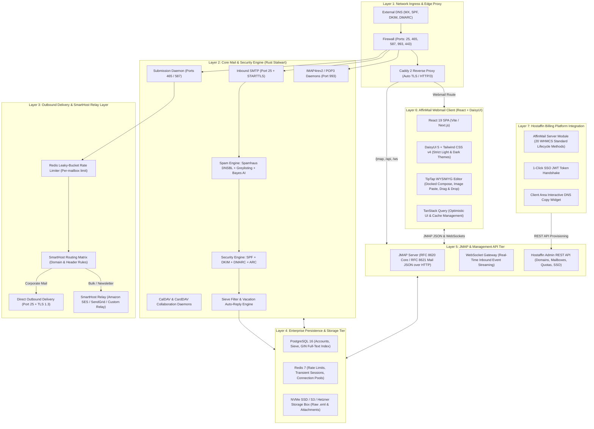

# AffinMail

> *"Enterprise Email Without Bloat: Ultra-fast, Privacy-Centric, Gmail-Class Simplicity."*

A modern, high-performance, privacy-first business email hosting platform combining:
1. **Rust Core Engine (Stalwart):** Sub-150MB idle memory, memory-safe, ultra-fast JMAP/IMAP/SMTP/CalDAV/CardDAV server.
2. **PostgreSQL 16 & Redis 7:** ACID persistence, GIN full-text search, and Leaky-Bucket rate limiting.
3. **Gmail-Class Webmail SPA:** Built with React 19, DaisyUI 5, and Tailwind CSS v4 featuring strict Light & Dark enterprise themes, TipTap docked compose, and global keyboard shortcuts.
4. **Dual-Path SmartHost Deliverability:** Clean Port 25 outbound delivery for corporate communications and dynamic relay routing (Amazon SES, SendGrid, Mailgun) for bulk mail.
5. **Hostaffin Billing Automation:** 20 standard WHMCS lifecycle methods, 1-click passwordless SSO, and interactive copyable DNS records widget.

---

## Complete Project Documentation Suite

All architectural blueprints, protocol specifications, database schemas, and integration guides are organized in the [`docs/`](file:///d:/AffinMail/docs/) directory:

| Document | Description |
| :--- | :--- |
| **[01-PRD.md](file:///d:/AffinMail/docs/01-PRD.md)** | Unified Product Requirements Document, business logic, functional & non-functional requirements, and personas. |
| **[02-TECHNICAL-ARCHITECTURE.md](file:///d:/AffinMail/docs/02-TECHNICAL-ARCHITECTURE.md)** | 7-Layer architectural blueprint, component responsibilities, network ingress, and data flow diagrams. |
| **[03-DATABASE-STORAGE-SCHEMA.md](file:///d:/AffinMail/docs/03-DATABASE-STORAGE-SCHEMA.md)** | Complete PostgreSQL 16 DDL schema, GIN indexes, Redis key structures, and Blob Storage specifications. |
| **[04-API-SPECIFICATIONS.md](file:///d:/AffinMail/docs/04-API-SPECIFICATIONS.md)** | RFC 8620/8621 JMAP specifications, Hostaffin Admin REST API endpoints, and WebSocket push notifications. |
| **[05-UI-UX-DESIGN-SYSTEM.md](file:///d:/AffinMail/docs/05-UI-UX-DESIGN-SYSTEM.md)** | Strict Light & Dark token specifications, Tailwind v4 + DaisyUI 5 setup, TipTap editor, and keyboard engine. |
| **[06-SECURITY-DELIVERABILITY.md](file:///d:/AffinMail/docs/06-SECURITY-DELIVERABILITY.md)** | 10/10 Deliverability guide (SPF, DKIM, DMARC, ARC), SmartHost matrix, Spamhaus DNSBL, and Redis Leaky-Bucket limiter. |
| **[07-HOSTAFFIN-INTEGRATION.md](file:///d:/AffinMail/docs/07-HOSTAFFIN-INTEGRATION.md)** | Complete specification of the 20 WHMCS lifecycle methods, 1-click SSO flow, and Client Area DNS widget. |
| **[08-DEVOPS-DEPLOYMENT.md](file:///d:/AffinMail/docs/08-DEVOPS-DEPLOYMENT.md)** | Single-VPS sizing guide, Docker Compose stack, Caddy 2 reverse proxy, and backup & recovery automation. |
| **[09-TESTING-QA-STRATEGY.md](file:///d:/AffinMail/docs/09-TESTING-QA-STRATEGY.md)** | Comprehensive QA strategy covering Vitest, Playwright E2E, PHPUnit driver tests, and deliverability audits. |
| **[10-IMPLEMENTATION-ROADMAP.md](file:///d:/AffinMail/docs/10-IMPLEMENTATION-ROADMAP.md)** | Directory tree structure and phased step-by-step checklist for building the platform end-to-end. |

---

## 7-Layer Architecture Overview

---

## Quick Reference: Hardware Requirements

* **Recommended VPS:** 2 vCPU, 4GB RAM, 80GB NVMe SSD (e.g. Hetzner CPX21 at ~€7/month).
* **Capacity:** 2,000–5,000 active business mailboxes with concurrent WebSocket connections.
* **Total Idle Stack Memory:** Under 800MB RAM total across all services.

---

## License
Proprietary & Confidential - Built for AffinMail / Hostaffin Ecosystem.
