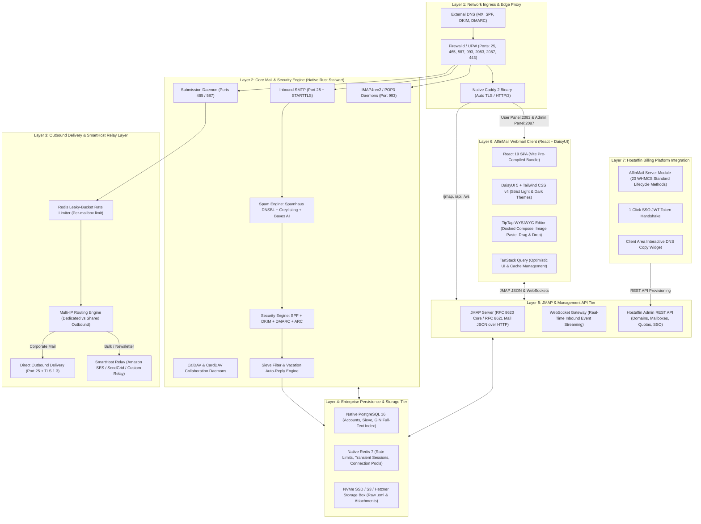

# AffinMail

> *"Optimized Workspace of Efficient Business."*
> High-Performance, Privacy-Centric Sovereign Business Email Platform Powered by Rust Stalwart.

A modern, high-performance, privacy-first business email hosting platform with **Zero Docker Dependency** running directly on bare-metal Linux:
1. **Rust Core Engine (Stalwart):** Native compiled binary, sub-100MB idle memory, memory-safe, ultra-fast JMAP/IMAP/SMTP/CalDAV/CardDAV server.
2. **Zero Docker Dependency (100% Native Systemd):** Direct native execution without container overhead, cgroup conflicts, or podman friction. Managed via native `systemd` units.
3. **Dual-CPU Native Architecture:** 100% native execution on both **ARM64** (Ampere Altra, AWS Graviton, Apple Silicon, Oracle ARM) and **x86_64** (Intel Xeon / AMD EPYC).
4. **Dual-Panel & Dual-Port Architecture:**
   - **Port 2087 (Admin Panel):** Dedicated cluster admin console (domains, quotas, multi-IP routing, storage management) — **100% automatable via REST API**.
   - **Port 2083 / 443 (User Panel):** Client webmail portal (JMAP, WebSockets, keyboard shortcuts) — **fully automatable via MCP (Model Context Protocol)**.
5. **Universal Linux Support:** First-class support for **AlmaLinux 8 / 9**, **Rocky Linux 8 / 9**, **RHEL**, **Ubuntu 22.04 / 24.04 LTS**, and **Debian 12**.
6. **Pluggable Dynamic Storage Engine:** Hot-swappable blob and attachment storage supporting **Local NVMe SSD**, **S3-Compatible Object Storage** (AWS, Cloudflare R2, MinIO, Wasabi), and **SFTP / Remote Storage Box** (Hetzner Storage Box).
7. **PostgreSQL 16 & Redis 7:** ACID persistence, GIN full-text search, and Leaky-Bucket rate limiting running natively on localhost.
8. **Gmail-Class Webmail SPA:** Built with React 19, DaisyUI 5, and Tailwind CSS v4 featuring strict Light & Dark enterprise themes, TipTap docked compose, and global keyboard shortcuts.
9. **Dual-Path SmartHost Deliverability:** Clean Port 25 outbound delivery for corporate communications and dynamic relay routing (Amazon SES, SendGrid, Mailgun) for bulk mail.
10. **Multi-IP & Dedicated IP Pool Architecture:** Granular outbound IP routing per domain (rotational shared pools for entry plans, dedicated outbound IPv4 for VIP clients) with automated progressive IP warm-up schedules and 24/7 RBL monitoring.
11. **Hostaffin Billing Automation:** 20 standard WHMCS lifecycle methods, 1-click passwordless SSO, and interactive copyable DNS records widget.

---

## ⚡ Quick Start: 1-Line Universal Installer

Run this single command as `root` on a fresh AlmaLinux, Rocky Linux, RHEL, Ubuntu, or Debian server:

```bash
bash <(curl -fsSL https://raw.githubusercontent.com/hostaffin/affinmail/master/install.sh 2>/dev/null || wget -qO- https://raw.githubusercontent.com/hostaffin/affinmail/master/install.sh)
```

The installer will:
- Auto-detect your CPU architecture (`x86_64` or `ARM64`)
- Auto-detect and safeguard your active SSH port in the firewall
- Auto-create a 2GB swap space if RAM is low to prevent OOM
- Install native PostgreSQL, Redis, Caddy 2, and Stalwart Mail binaries
- Initialize database schemas and configure native systemd services
- Output your Admin Panel (`:2087`) and User Panel (`:2083`) URLs

---

## 🛠️ Unified Terminal Management CLI

AffinMail provides a master command-line utility linked at `/usr/local/bin/affinmail`:

```bash
affinmail status          # Check systemd services and listening ports
affinmail restart         # Restart Stalwart, Caddy, PostgreSQL, and Redis
affinmail fix             # Emergency diagnostic and auto-repair tool
affinmail logs stalwart   # Live stream mail server logs
affinmail logs caddy      # Live stream web server / proxy logs
affinmail logs install    # View real-time installation output log
affinmail backup          # Instant gzipped PostgreSQL dump to /opt/affinmail/backups/
affinmail update          # Zero-downtime rolling update & schema migrations
affinmail info            # Display hostname, outbound IP, and storage configuration
affinmail uninstall       # Cleanly remove services (--purge-all for complete wipe)
```

---

## Complete Project Documentation Suite

All architectural blueprints, protocol specifications, database schemas, and integration guides are organized in the [`docs/`](file:///d:/AffinMail/docs/) directory:

| Document | Description |
| :--- | :--- |
| **[01-PRD.md](file:///d:/AffinMail/docs/01-PRD.md)** | Unified Product Requirements Document, business logic, functional & non-functional requirements, and personas. |
| **[02-TECHNICAL-ARCHITECTURE.md](file:///d:/AffinMail/docs/02-TECHNICAL-ARCHITECTURE.md)** | 7-Layer architectural blueprint, component responsibilities, network ingress, and data flow diagrams. |
| **[03-DATABASE-STORAGE-SCHEMA.md](file:///d:/AffinMail/docs/03-DATABASE-STORAGE-SCHEMA.md)** | Complete PostgreSQL 16 DDL schema, GIN indexes, Redis key structures, and Blob Storage specifications. |
| **[04-API-SPECIFICATIONS.md](file:///d:/AffinMail/docs/04-API-SPECIFICATIONS.md)** | RFC 8620/8621 JMAP specifications, Hostaffin Admin REST API endpoints, and WebSocket push notifications. |
| **[05-UI-UX-DESIGN-SYSTEM.md](file:///d:/AffinMail/docs/05-UI-UX-DESIGN-SYSTEM.md)** | Strict Light & Dark token specifications, Tailwind v4 + DaisyUI 5 setup, TipTap editor, and keyboard engine. |
| **[BRANDING-GUIDELINES.md](file:///d:/AffinMail/docs/BRANDING-GUIDELINES.md)** | Official brand identity, Sovereign Wing logomark anatomy, color tokens, typography, and asset specifications. |
| **[06-SECURITY-DELIVERABILITY.md](file:///d:/AffinMail/docs/06-SECURITY-DELIVERABILITY.md)** | 10/10 Deliverability guide (SPF, DKIM, DMARC, ARC), SmartHost matrix, Spamhaus DNSBL, and Redis Leaky-Bucket limiter. |
| **[07-HOSTAFFIN-INTEGRATION.md](file:///d:/AffinMail/docs/07-HOSTAFFIN-INTEGRATION.md)** | Complete specification of the 20 WHMCS lifecycle methods, 1-click SSO flow, and Client Area DNS widget. |
| **[08-DEVOPS-DEPLOYMENT.md](file:///d:/AffinMail/docs/08-DEVOPS-DEPLOYMENT.md)** | Bare-metal native systemd deployment, single-VPS sizing guide, Caddy 2 reverse proxy, and backup & recovery automation. |
| **[09-TESTING-QA-STRATEGY.md](file:///d:/AffinMail/docs/09-TESTING-QA-STRATEGY.md)** | Comprehensive QA strategy covering Vitest, Playwright E2E, PHPUnit driver tests, and deliverability audits. |
| **[10-IMPLEMENTATION-ROADMAP.md](file:///d:/AffinMail/docs/10-IMPLEMENTATION-ROADMAP.md)** | Directory tree structure and phased step-by-step checklist for building the platform end-to-end. |
| **[11-AI-AGENT-API-AUTOMATION-PLAN.md](file:///d:/AffinMail/docs/11-AI-AGENT-API-AUTOMATION-PLAN.md)** | Autonomous AI Agent Admin REST API automation plan, function schemas, and self-healing workflows. |

---

## 7-Layer Architecture Overview



---

## Hardware Sizing & Memory Benchmark

| Architecture | Recommended Sizing | Memory Footprint (Zero Docker) | Monthly Cost |
| :--- | :--- | :--- | :--- |
| **ARM64 VPS** | 2-4 vCPUs (Ampere Altra), 4-8 GB RAM | **~280 MB RAM total idle** | ~€4 - €6 / mo |
| **x86_64 VPS** | 2-4 vCPUs (AMD EPYC / Intel), 2-4 GB RAM | **~290 MB RAM total idle** | ~€5 - €7 / mo |

- **PostgreSQL 16 native:** ~45 MB RAM
- **Redis 7 native:** ~15 MB RAM
- **Stalwart Mail Engine native binary:** ~35 MB RAM
- **Caddy 2 native binary:** ~20 MB RAM
- **Total stack:** Runs comfortably on even a 1GB/2GB VPS with zero OOM issues!

---

## License
Proprietary & Confidential - Built for AffinMail / Hostaffin Ecosystem.
