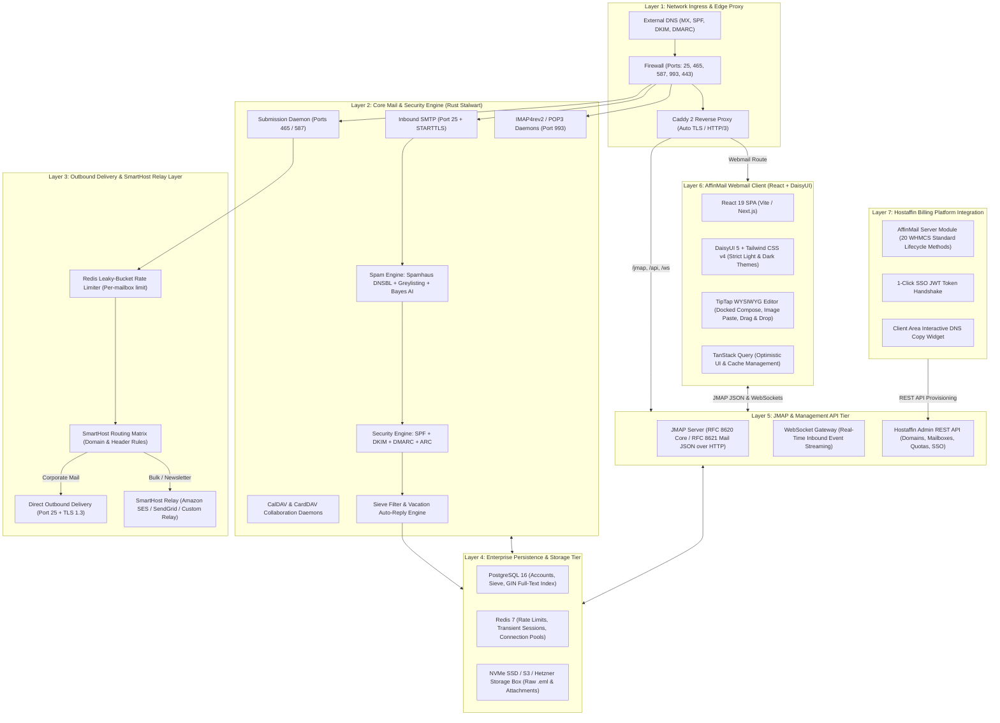

# AffinMail: Complete 7-Layer Technical Architecture Specification

---

## 1. System Overview & Architecture Philosophy

AffinMail is engineered with a strict 7-layer decoupled architecture. Each layer maintains single-responsibility boundaries, enabling independent scaling, rapid debugging, zero-downtime maintenance, and strict security segmentation.

---

## 2. Deep Layer-by-Layer Breakdown

### Layer 1: Network Ingress & Edge Proxy
* **Caddy 2 Reverse Proxy:**
  * Handles TLS termination using Let's Encrypt / ZeroSSL with ACME automation.
  * Terminates HTTP/2 and HTTP/3 (QUIC) for fast mobile performance.
  * Directs `/jmap`, `/api/v1`, and `/ws` traffic to Stalwart JMAP/REST listeners.
  * Serves the pre-compiled Webmail SPA static bundle (`dist/`) directly from NVMe, reducing Node.js runtime load to 0 MB.
* **Linux Netfilter / UFW Firewall:**
  * Exposes required mail ports:
    * `25/tcp`: Inbound SMTP MX (Clean traffic, DNSBL filtered).
    * `465/tcp`: Implicit TLS SMTP submission.
    * `587/tcp`: STARTTLS SMTP submission.
    * `993/tcp`: Implicit TLS IMAP4rev2.
    * `80/tcp`, `443/tcp`: HTTP/HTTPS for Webmail & JMAP.
  * Enforces fail2ban rate drops on repeated bad auth attempts.

### Layer 2: Core Mail & Security Engine (Rust Stalwart)
* Built on **Stalwart Mail Server** (written in Rust), ensuring zero buffer-overflow vulnerabilities, ultra-low concurrency memory overhead (under 150MB), and asynchronous I/O via Tokio.
* **Protocol Engines:**
  * Inbound SMTP daemon listening on Port 25.
  * Authenticated submission engine with mandatory SASL (PLAIN, SCRAM-SHA-256).
  * IMAP4rev2 and POP3 daemons with IDLE push notification support.
  * CalDAV / CardDAV sync engines adhering to RFC 4791 and RFC 6352.
* **Security & Spam Evaluation Pipeline:**
  * Multi-stage spam inspection: Spamhaus Zen / DBL DNSBL lookup -> Greylisting -> SPF/DKIM/DMARC/ARC verification -> Statistical Bayes engine -> Sieve filter execution.

### Layer 3: Outbound Delivery & SmartHost Relay Layer
* **Dual-Path Routing Mechanism:**
  * **Path A (Direct Outbound):** Transactional/Corporate emails are dispatched directly from the clean local IPv4/IPv6 address via Port 25 with opportunistic TLS 1.3 and DANE verification.
  * **Path B (SmartHost Relay):** Bulk/Marketing mail, or accounts flagged as marketing senders, are automatically routed through external high-volume relays (Amazon SES, SendGrid, Mailgun, Brevo) with authenticated SMTP credentials.
* **Leaky-Bucket Rate Limiter:**
  * Tracks hourly sending frequency per mailbox in Redis.
  * If a mailbox exceeds its assigned threshold (e.g. 200/hr), subsequent submission requests are rejected with `451 4.7.1 Message rate limit exceeded. Try again in X minutes.`

### Layer 4: Enterprise Persistence & Storage Tier
* **PostgreSQL 16:**
  * Stores domains, mailboxes, aliases, routing configuration, Sieve scripts, and message metadata.
  * Leverages GIN indexes for rapid full-text search across email headers, subjects, and text bodies.
* **Redis 7:**
  * In-memory cache for Leaky-Bucket counters, active JMAP/WebSocket session tracking, and temporary token blacklists.
* **Blob Storage Engine (NVMe SSD / S3 / Hetzner Storage Box):**
  * Content-addressable raw message payloads (`.eml`) and attachments stored either locally on high-speed NVMe or offloaded to S3-compatible object storage with SHA-256 deduplication.

### Layer 5: JMAP & Management API Tier
* **JMAP (RFC 8620 Core & RFC 8621 Mail):**
  * Modern JSON-over-HTTP protocol replacing IMAP for web and mobile clients.
  * Allows batched requests, delta updates, and atomic multi-method invocations (`Email/get`, `Email/query`, `Email/set`, `Thread/get`).
* **WebSocket Gateway:**
  * Push notifications for inbound messages, folder changes, and unread count badges.
* **Admin REST API:**
  * Endpoints utilized by the Hostaffin billing driver for automated lifecycle provisioning, quota updates, DKIM key retrieval, and SSO token generation.

### Layer 6: AffinMail Webmail Client (React 19 + DaisyUI 5)
* Single-page application built on React 19, DaisyUI 5, and Tailwind CSS v4.
* Docked compose window supporting minimizing, multiple drafts, TipTap rich text, drag-and-drop attachments, and real-time client-side file-size guard.
* Gmail-standard hotkey engine (`c`, `j`, `k`, `e`, `#`, `s`, `r`, `a`, `/`).
* Optimistic UI updates powered by TanStack Query.

### Layer 7: Hostaffin Billing Platform Integration
* Custom server module located at `app/Modules/Servers/AffinMail/`.
* Implements 20 WHMCS standard lifecycle methods (`createAccount`, `suspendAccount`, `unsuspendAccount`, `terminateAccount`, `changePassword`, `changePackage`, `usageUpdate`, etc.).
* Generates 1-click single-use SSO tokens (JWT, 120s TTL) for passwordless Webmail entry.
* Injects an interactive DNS records table into the customer client area with 1-click copy buttons for MX, SPF, DKIM, and DMARC.

---

## 3. High-Level Data Flow Scenarios

### Inbound Mail Processing Flow
1. Remote MTA contacts AffinMail Port 25.
2. Inbound SMTP evaluates sender IP against Spamhaus DNSBL and IP reputation tables.
3. STARTTLS handshake negotiates TLS 1.3 encryption.
4. DKIM signatures, SPF records, and DMARC policies are evaluated and ARC headers added.
5. Sieve scripts execute user-defined routing (e.g. move to folder, forward, vacation reply).
6. Message body and attachments are stored in Blob Storage; metadata indexed in PostgreSQL.
7. WebSocket event dispatched to active Webmail sessions to display incoming email immediately.

### Outbound Mail Submission Flow
1. User clicks "Send" in Webmail (or submits via Port 465/587).
2. Client checks attachment size against plan limit before transmission.
3. Server verifies authenticated credentials and queries Redis Leaky-Bucket rate counter.
4. SmartHost routing rules check if sender domain/profile uses Direct Delivery or SmartHost Relay.
5. If direct: Mail is signed with domain DKIM key and dispatched to recipient MX.
6. If relay: Mail is wrapped, signed, and forwarded to Amazon SES / configured relay.
