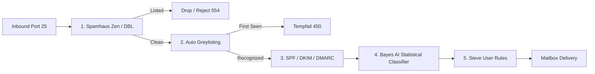

# AffinMail: Security, Deliverability & Compliance Specification

---

## 1. Executive Deliverability Philosophy
Deliverability is the core value proposition of AffinMail. Business communication cannot afford spam folder placement or IP reputation contamination. AffinMail guarantees 10/10 deliverability via strict protocol isolation and cryptographic enforcement.

---

## 2. 10/10 Deliverability Architecture

### 2.1 Cryptographic Authentication Stack
Every outgoing and incoming email undergoes strict verification:
1. **SPF (Sender Policy Framework - RFC 7208):**
   * Record: `v=spf1 mx include:_spf.hostaffin.com ~all`
   * Aligns Envelope Sender (`Return-Path`) with client domain.
2. **DKIM (DomainKeys Identified Mail - RFC 6376):**
   * Dedicated 2048-bit RSA key generated per domain.
   * Canonicalization: `relaxed/relaxed` for headers and body.
   * Selector: `affinmail._domainkey.customerdomain.com`.
3. **DMARC (Domain-based Message Authentication - RFC 7489):**
   * Enforced policy: `v=DMARC1; p=quarantine; pct=100; rua=mailto:dmarc@hostaffin.com`.
   * Requires strict SPF and DKIM identifier alignment.
4. **ARC (Authenticated Received Chain - RFC 8617):**
   * Preserves authentication results across intermediate forwarders and mailing lists.
5. **Reverse DNS (PTR):**
   * Dedicated IPv4 and IPv6 PTR records match the primary HELO/EHLO hostname: `mail.hostaffin.com`.

### 2.2 Dual-Path SmartHost Routing Matrix

```
                      Outbound Email Submission
                                 │
                                 ▼
                     Check Sender & Header Policy
                                 │
                 ┌───────────────┴───────────────┐
                 ▼                               ▼
    [Direct Clean IP Route]            [SmartHost Relay Route]
                 │                               │
       - Personal 1-to-1 mail          - Bulk newsletters
       - High-trust business mail      - High-volume notifications
       - Zero spam history             - Risk-mitigated external IPs
                 │                               │
                 ▼                               ▼
     Port 25 Direct Outbound             Amazon SES / SendGrid
        (TLS 1.3 + DANE)                   (Authenticated SMTP)
```

| Criteria | Route Assignment | Transport Channel |
| :--- | :--- | :--- |
| Standard Executive / Corporate Mailbox | `direct` | Clean Hostaffin IPv4 / IPv6 via Port 25 |
| E-Commerce Notification Account | `relay_ses` | Amazon SES SMTP (Port 587 + TLS) |
| High-Volume Marketing / Newsletter | `relay_sendgrid` | SendGrid SMTP Relay |
| Dedicated Enterprise Relay | `relay_custom` | Custom customer-provided SmartHost |

### 2.3 Multi-IP Pool Management & Reputation Isolation
To prevent cross-tenant deliverability contamination:
1. **Shared IP Pool:** General hosting accounts route outbound email through a round-robin pool of clean shared IPs.
2. **Dedicated Per-Domain IP:** Enterprise clients receive a private, dedicated public IPv4 address bound to their domain. No other domain can transmit packets from this IP address.
3. **Automated PTR / HELO Binding:** Stalwart dynamically emits the exact EHLO matching the outbound interface IP (`bind = "<assigned_ip>"`), guaranteeing 100% rDNS consistency.

### 2.4 Automated Dedicated IP Warm-Up Engine
New dedicated IPs have no historical reputation with Gmail, Yahoo, or Microsoft, and sending large bursts immediately will trigger bulk spam throttling. AffinMail includes an automated progressive warm-up engine:

| Warm-up Day | Max Daily Limit | Spillover Action |
| :--- | :--- | :--- |
| **Days 1–3** | 50 emails/day | Excess mail seamlessly routed to pre-warmed Shared Pool |
| **Days 4–7** | 150 emails/day | Excess mail routed to Shared Pool |
| **Days 8–14** | 500 emails/day | Excess mail routed to Shared Pool |
| **Days 15–21** | 1,500 emails/day | Excess mail routed to Shared Pool |
| **Days 22–30** | 5,000 emails/day | Excess mail routed to Shared Pool |
| **Day 31+** | **Full Plan Quota (Unrestricted)** | Standard dedicated delivery |

*Status is tracked in PostgreSQL `ip_warmup_schedules` table with daily midnight cron resets.*

### 2.5 Continuous RBL / Blacklist Guard & Standby Failover
* An hourly background daemon tests every IP in the pool against 15+ major DNSBLs (Spamhaus Zen, Barracuda, SORBS, SpamCop, Invaluement).
* If an IP is flagged:
  1. The IP's `is_blacklisted` flag is marked `TRUE` in PostgreSQL.
  2. Outbound traffic for attached domains is immediately switched to a healthy Standby Clean IP.
  3. An automated alert webhook is dispatched to the Hostaffin NOC team with delisting links.

---

## 3. Rate Limiting: Redis Leaky-Bucket Algorithm

To prevent compromised accounts or infected workstations from launching spam waves, outbound traffic is metered using a Leaky-Bucket rate limiter:

### Algorithm Specification
* **Bucket Capacity ($C$):** Maximum burst allowance (e.g. 50 messages).
* **Leak Rate ($r$):** Allowance regeneration per second (e.g. $200 / 3600 \approx 0.055$ messages/sec).
* **Evaluation on Submission:**
  1. Retrieve current water level $W$ and timestamp $T_{last}$ from Redis key `ratelimit:send:<mailbox_id>`.
  2. Compute elapsed time $\Delta t = T_{now} - T_{last}$.
  3. Compute leaked water: $W_{new} = \max(0, W - \Delta t \times r)$.
  4. If $W_{new} + 1 > C$: **Reject submission** with SMTP status `451 4.7.1 Sending quota exceeded. Try again later.`
  5. Else: Update Redis with $W_{new} + 1$ and $T_{now}$; allow dispatch.

---

## 4. Inbound Multi-Stage Spam Defense Engine



1. **DNSBL Filtering:** Queries Spamhaus Zen (`sbl.spamhaus.org`, `xbl.spamhaus.org`, `pbl.spamhaus.org`) and SURBL. Immediate rejection of confirmed botnets.
2. **Automated Greylisting:** Unknown sender tuples (Client IP, Sender, Recipient) are temporarily deferred with code 450 for 5 minutes. Legitimate mail servers retry automatically; spam bots disconnect.
3. **Statistical Bayes AI:** Analyzes n-grams, header patterns, and body tokens to compute spam probability score (0.0 to 10.0). Scores above 7.0 automatically move mail to the `Spam` folder.

---

## 5. Single Sign-On (SSO) JWT Security Architecture

To facilitate seamless 1-click login from Hostaffin without compromising password hashes:
1. **Token Generation:** Hostaffin backend requests a signed JWT from Stalwart Management API with:
   * `sub`: Mailbox UUID
   * `email`: `marcus@apexlogistics.com`
   * `exp`: $T_{now} + 120$ seconds (Strict 2-minute life)
   * `jti`: Unique random UUID (one-time use nonce)
2. **One-Time Nonce Invalidation:**
   * Upon Webmail redemption, Stalwart writes `jti` to Redis with 120s TTL.
   * If the token is re-submitted, Redis flags it as consumed and rejects the attempt.
3. **Session Issuance:**
   * After verification, the Webmail client receives an `HttpOnly`, `Secure`, `SameSite=Strict` session cookie and JMAP Bearer token.
